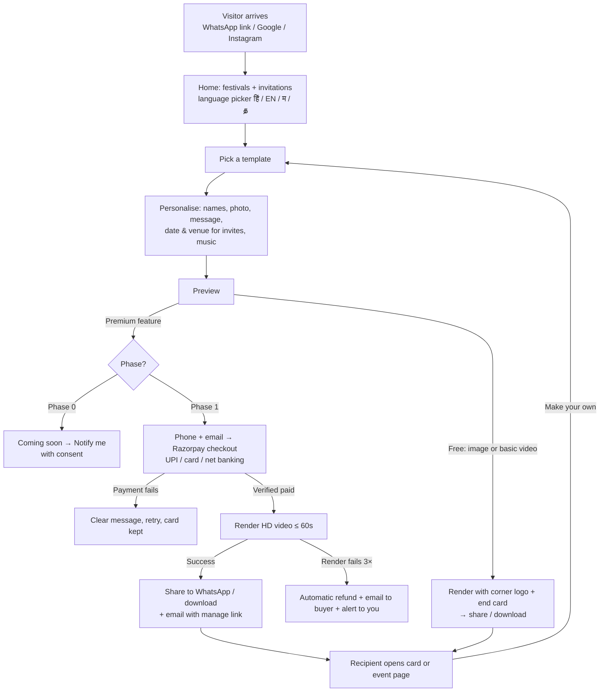

# 09 — Lean Launch Plan (solo founder + Claude)

**Status:** Draft v3 · **Updated** after the founder's decisions: launch free first, and the brand name **CardReel**. v2 (25 Oct 2026) followed the independent review (`10-prd-review.md`); first written 2 Oct 2026.
**Supersedes** the timeline, team and budget in `08-roadmap-team-cost-gtm.md` for the first launch. The full PRD (`02`–`07`) stays the long-term target. This document is the **bare minimum version** we ship first.
**Related:** `12-business-setup-razorpay-gst.md` (entity, Razorpay, GST) · `13-brand-identity.md` (CardReel brand).

Labels: **[V]** sourced · **[E]** estimate · **[A]** assumption.

---

## 0. Phase 0: free launch (decided)

We **go live free first**, then switch on payments. That removes Razorpay KYC, GST and entity paperwork from the launch's critical path. It also cuts about 3 build days and lets the market tell us what people would pay for.

| | Phase 0: free launch | Phase 1: freemium (payments on) |
|---|---|---|
| **When** | **Day 11** after the PRD go-ahead: staging by Day 3, a testing week, then production (`15-release-plan.md`) | **Day 18**, one week after the free launch, once the payments gate passes (`15` §3.3) |
| **Free** | All greetings (image **and** video); image invitations; a **basic video invitation** (≤ 30s, 1 photo, 1 family side) | The same free tier stays. **Nothing that was free becomes paid** |
| **Premium** | Shown as **"Premium — coming soon"**, with a **"Notify me"** button (explicit consent, DPDP) | Multi-photo, **both family-side versions**, multi-function event page + RSVP, no branding, HD + PDF, edits window (prices in §5) |
| **Branding on free output** | Small corner logo + a 2-second end card: **"Made with CardReel — make yours free"** | Same on free; removed on premium |
| **Payments** | None. No Razorpay keys needed to go live | Razorpay hosted checkout, verified webhooks, automatic refunds (`05`, `12`) |

**Guardrails (cost and abuse):**
- About **5 free video renders per device per day**.
- Cloudflare **Turnstile** bot check on render requests.
- A render **queue** with "we'll notify you when it's ready" at peaks.
- The link-lifetime policy (§2) caps storage.

**When payments switch on (founder's timeline).** Payments go live **one week after the free launch (Day 18)** if the payments gate passes: Razorpay KYC approved, payment tests passed, a live ₹1 purchase and refund verified (`15` §3.3). If KYC isn't approved by then, we stay free and switch on the day it is.

The "Notify me" rate and waitlist (`11-analytics-tracking-plan.md` §4.9) are **tracked to size demand and set priorities**. They **no longer gate** the switch-on date.

**Phase 1 scope (assumed; founder to confirm):** sell **only premium invitations** (₹199 Standard / ₹399 Premium) at first. Greetings and image invites stay free with branding (`14` §F3).

**Never** give premium features away free and then take them back. Starting a new paid tier is fine; downgrading a free feature breaks trust.

---

## 1. What changed and why

| Founder input | What it means for the plan |
|---|---|
| Staging in 2–3 days, a testing week, a free week, then payments | **Staging by Day 3, free production launch on Day 11, payments on Day 18** after the PRD go-ahead (`15-release-plan.md`). The original 16 Oct target passed before the build began. |
| Go live free initially | Removes KYC, GST and entity from the critical path; measures demand with "Notify me" (§0). |
| Solo founder; Claude does the development | No team payroll. Managed services only. Claude also writes the templates as code. You handle accounts, KYC, testing on phones, and marketing. |
| Video invitations for Diwali and weddings | Launch catalogue = greetings (Diwali tail, Bhai Dooj, birthdays) + wedding and griha pravesh invitations (image + basic video free; premium video in Phase 1). |
| Brand name | **CardReel** (`cardreel.in`). Full details in `13-brand-identity.md`. |
| Start slow on budget | About **₹6–7k a month** of fixed cost; no ads needed to launch (₹10–20k optional). |

---

## 2. Scope: what's in at go-live (Phase 0) and in Phase 1

| Area | In at go-live (Phase 0) | Phase 1 / deferred |
|---|---|---|
| Catalogue | Diwali tail (Bhai Dooj), birthdays, wedding and griha pravesh invitations | More festivals added each week; Good Morning |
| Languages | Hindi, English, Marathi, Tamil: UI + template text. Claude translates; **a native speaker reviews Marathi and Tamil** | More languages |
| Editor | Guided slots: names, photo, message, date/time/venue (invites), music choice, language | Background removal, transliteration, AI wish writer (replaced by **ready-written wishes per language**) |
| Output | Free image and video with the corner logo + end card. **Invitations also export JPG + PDF.** **WhatsApp-safe video spec:** ≤ 60s, 9:16 1080×1920, H.264, text kept inside safe zones and above a minimum size so it survives WhatsApp compression; a "send as document for full HD" tip | Premium HD without branding (Phase 1); print-ready PDF with bleed |
| Sharing | WhatsApp **file** share first, then link share and download; **recipient page with "Make your own"** | Replies ("send wishes back"); sender "viewed N times" summary (P1) |
| Trust and safety | Share text says "Video invitation — no app download needed"; pages **never** ask for a download or install; "Safe link: no app, no login" line on event pages; user content may only link to allowlisted sites (Google Maps, YouTube); "Report" button; photo-rights and acceptable-use terms shown at upload | Automated content moderation (P1) |
| Invitations | **Indian invitation content model:** inviting family, optional relatives list, muhurat/time, ritual/function list, RSVP contact persons, religious header symbol (Ganesha / Om / Ik Onkar / Bismillah / Cross / Jain / none). Event page with map link and add to calendar | **Phase 1 premium:** both family-side versions, multi-function schedule, RSVP. **P1:** RSVP export, co-hosts, guest reminders and update notices, QR code, livestream link, save-the-date and thank-you cards |
| Accounts | **No login.** Optional email to receive a private "manage" link for re-download and edits | OTP login, My Cards dashboard |
| Premium interest | **"Premium — coming soon" + "Notify me"** (email or WhatsApp, explicit consent) | Replaced by checkout in Phase 1 |
| Payments | **None in Phase 0** | **Phase 1:** Razorpay hosted checkout (UPI intent/QR, cards, net banking), verified webhooks, **automatic refund if the render fails**, emailed receipt. Later: coupons, referrals, Pass, Business Plan, second gateway |
| Ops | Log tables (renders, errors, and payments/webhooks/refunds from Phase 1); **email alerts to you** for render failures (plus payment and refund failures from Phase 1); **analytics per `11-analytics-tracking-plan.md`**; Sentry errors | Grafana dashboards, PagerDuty, daily reconciliation report (Phase 1, week 3) |
| Admin | Templates are added in code by Claude; data viewed in the Supabase dashboard (Razorpay dashboard from Phase 1) | Admin CMS |
| Support | FAQ in 4 languages; WhatsApp Business number with auto-replies; manage-link lookup; reply within 24h (4h on festival days) | Ticketing tool |
| Link lifetime | Free cards: link live 12 months. Paid cards: 3 years. Event pages: live until 90 days after the last function, then archived; RSVP data deleted after 12 months. Stated on the pricing page | Host-paid extensions |
| Honest pricing | Premium prices shown as "coming soon" (needed for Razorpay review). No strike-through until a price has actually been charged for 30 days. Badges are "New" and festival labels only, until real data exists | Data-driven Bestseller/Trending badges (once there are ≥ 25 orders in 7 days) |

---

## 3. User flow

---

## 4. Lean tech stack

| Need | Choice | Monthly cost **[E]** | Why |
|---|---|---|---|
| Website (Next.js, 4 languages, SEO) | **Vercel Pro** | ~₹1,800 ($20) | Fastest to ship and deploy; commercial use needs the Pro plan |
| Database + file storage for uploads | **Supabase Pro**, Mumbai region | ~₹2,200 ($25) | Postgres + storage + daily backups in one service, hosted in India |
| Video render worker (FFmpeg + headless Chromium) | **DigitalOcean droplet in Bangalore**, 2 vCPU / 4 GB | ~₹2,100 ($24); resize for peak weeks (+~₹1,000 prorated) | Renders 200–300 videos an hour **[E]**; jobs queue in Postgres |
| Rendered videos/images delivery | **Cloudflare R2** + Cloudflare DNS/CDN/WAF/Turnstile (free plan) | ₹0–500 | Zero egress fees; DDoS and bot protection |
| Payments (Phase 1) | **Razorpay** | ₹0 fixed; ~2% per payment + 18% GST on the fee **[V]** | Best docs, UPI intent, refund API, quick onboarding (`12`) |
| Email (manage links, notify-me, alerts) | **Resend** (free tier 3,000/month) | ₹0 | Simple API |
| Analytics / errors | **PostHog** + **Sentry** (free tiers) | ₹0 | Funnels and error tracking from day 1 |
| Domain | **cardreel.in** (GoDaddy) | ₹1 first year; check the renewal price | — |
| Business email | **Zoho Mail**: support@cardreel.in | ₹0 | Needed for Razorpay and trust |
| **Total fixed** | | **≈ ₹6,000–7,000/month** | |

**Video templates are built as code:** each template is an HTML/CSS/SVG animation with slots. The worker opens it in headless Chromium (which shapes Hindi, Marathi and Tamil text correctly), captures the frames, and encodes an MP4 with FFmpeg, adding the music. Claude can author these templates. Quality will be clean and modern, but not at the level of a professional motion designer. Once revenue comes in, buy or commission 3–5 hero templates.

---

## 5. Pricing

**Phase 0:** everything below marked "Free" is live; premium items show their price with **"coming soon"**.
**Phase 1:** premium switches on. Not registered for GST at launch (see `12` §3), so these are the full prices.

| Product | Phase 0 | Phase 1 price | What you get |
|---|---|---|---|
| Image greeting | **Free** | Free | Name + photo, small corner logo, share/download |
| Video greeting (15–20s, music) | **Free** (with logo + end card) | Free. *Later:* ₹29 for HD without branding, if demand shows | HD, no branding, 3 edits within 7 days |
| Image invitation (wedding, puja/party, griha pravesh) | **Free** with small logo | Free. *Later:* ₹49 without logo, if demand shows | JPG + PDF + event page |
| Basic video invitation (≤ 30s, 1 photo, 1 family side) | **Free** (with logo + end card) | Free | Video + event page with map and add-to-calendar |
| Wedding video invitation: Standard | Coming soon | **₹199** | 30–40s, 2 photos, 1 language, 1 family side, no branding, JPG + PDF |
| Wedding video invitation: **Premium (Recommended)** | Coming soon | **₹399** | 45–60s, up to 6 photos, **both family-side versions**, multi-function event page + RSVP, JPG + PDF, unlimited edits for 14 days |

**Unit economics per sale (Phase 1) [E]:**

| Sale | Gateway fee | Render + delivery | You keep |
|---|---|---|---|
| ₹29 video greeting | ~₹0.70 | ~₹0.20 | ≈ ₹28 |
| ₹399 wedding invite | ~₹9.40 | ~₹1 | ≈ ₹388 |

**Break-even on fixed costs:** about **17 Premium wedding invites** or **230 HD video greetings** a month.

**Cost of the free phase:** fixed costs only (≈ ₹6–7k/month). Free renders cost well under ₹1 each **[E]**. If it goes viral, the daily render cap and queue protect the budget; add a second render server (~₹2k/month) only if needed.

**About the discount display:** India's 2023 rules on dark patterns (from the consumer protection authority, CCPA) make a strike-through "MRP" that was never charged illegal. We use **"launch price"** and **"Recommended"** labels instead. Real strike-through prices and "Bestseller" badges switch on automatically once there's genuine price history and sales data.

---

## 6. Schedule

**The detailed plan is in `15-release-plan.md`.** Day 0 = the founder confirms the PRD.

| Stage | Days | Example (Day 0 = Tue 27 Oct 2026) |
|---|---|---|
| Staging build (`staging.cardreel.in`, private) | D1–D3 | 28–30 Oct |
| Testing week + fixes; payments built in test mode | D4–D10 | 31 Oct – 6 Nov |
| **Production live, free** (`cardreel.in`); submit Razorpay KYC | D11–D17 | **Sat 7 Nov** – 13 Nov |
| **Payments live** (premium invitations) | D18 | **Sat 14 Nov** |

**Critical path:** native-speaker review, template quality and licensed music for the free launch; **Razorpay KYC approval** for payments.

---

## 7. Go-live checklist (what you provide)

### Must have for Phase 0 (free launch)
- [ ] **Domain `cardreel.in`** bought in **your name exactly as on your PAN** (Razorpay matches names later). Turn on auto-renew and two-step login at GoDaddy.
- [ ] **Social handles** reserved: @cardreel (or @cardreel.in, the same everywhere). See `13` §2.
- [ ] **Business email** support@cardreel.in (Zoho Mail free) and a **contact phone number** shown on the site, as the consumer e-commerce rules require.
- [ ] **Accounts** (free to create; Claude will guide you): GitHub, Vercel, Supabase, Cloudflare, DigitalOcean, Resend, PostHog, Sentry, Google Search Console.
- [ ] **API keys entered by you** into Vercel/Supabase settings. Never paste secrets into chat.
- [ ] **Native-speaker reviewers** for Marathi and Tamil (a few hours each), ideally people who know **wedding invitation conventions** (family names, relatives list, wording).
- [ ] **WhatsApp Business number** for support (can be your second number).
- [ ] **Music**: 5–8 tracks with a licence that allows use inside videos you distribute (royalty-free packs; ₹0–5,000).
- [ ] **Test devices**: one low-end Android phone + WhatsApp; an iPhone if possible.
- [ ] **Grievance contact** (can be you) named on the site.
- [ ] **Free IP India trademark search** for CARDREEL / CARD REEL / CARDREAL (filing is deferred; see `13` §3).

### Needed for Phase 1 (payments)
- [ ] **PAN + a bank account in your name.** Start as an **individual** on Razorpay. Move to a **sole proprietorship** (Udyam + a second business proof + a current account) once sales start. See `12` §1.
- [ ] **Razorpay KYC** submitted once the site is live. Have your **original physical PAN card** ready in case of video KYC (printouts and e-PAN on screen aren't accepted).
- [ ] **Website pages Razorpay checks:** About, Contact, Pricing, Terms, Privacy, Cancellation/Refund (+ a Delivery policy for digital goods). Claude builds these on Day 1.
- [ ] **A 30-minute CA consultation** (~₹1–2k) to confirm the GST threshold for your state, using a personal account at first, and the presumptive tax scheme.

### Not needed now
- **GST registration:** not required while service turnover stays under ₹20 lakh a year (₹10 lakh in some special-category states), even when selling across states **[A: confirm with a CA]**. Details in `12` §3.
- A company or LLP (start as an individual; incorporate only for funding or a co-founder).
- A lawyer (Claude drafts the policies; an optional ₹5–15k review later).
- Trademark **filing** (deferred by the founder; ~₹4,500 per class when filed).

---

## 8. Brand

**Name: CardReel** (कार्डरील · கார்டுரீல்) · **Domain: `cardreel.in`** · **Tagline:** "Wishes, Cards & Video Invitations for every occasion".
- **"Card + Reel"** covers both formats we make, image cards and videos. It's neutral English, works for every occasion, and is easy to say and spell across India.
- **No conflicting app or brand found.** Watch-outs:
  - "card reel" is also the name of a retractable ID-badge holder (mixed search results early on);
  - `cardreel.com` is parked and for sale;
  - use "Reel", never "Reels" (Instagram).
- **SEO comes from the site, not the name:** festival × language landing pages, `.in`, speed, structured data, YouTube Shorts (`13` §6).

Full brand identity (handles, trademark plan, logo, colours, fonts): **`13-brand-identity.md`**.

---

## 9. Costs summary

| | Amount **[E]** |
|---|---|
| One-time to launch | ₹1–5k (domain, music) |
| Fixed monthly | ₹6–7k |
| Peak-week server resize | ~₹1k |
| Per sale (Phase 1) | ~2.4% gateway fee (incl. GST on the fee) + < ₹1 render |
| Optional promotion | ₹10–20k (Instagram/Facebook boosts in Hindi/Marathi/Tamil) |
| Trademark filing (later) | ~₹4,500 per class |
| Your Claude subscription | Separate (whatever plan you're on) |

**Scale-up path:** stay on this stack up to roughly 50–100k monthly users. Then move step by step to the PRD architecture (`04-system-design.md`): queue-based worker autoscaling, OTP accounts, an admin CMS and a second gateway. Most of the code carries over.

---

## 10. Risks of the lean approach

| Risk | Mitigation |
|---|---|
| Users get used to everything being free | Premium features are never given away; they launch as a new tier. Free branding (logo + end card) stays |
| Weak willingness to pay | "Notify me" rate tells us before we build too much; switch-on rule in §0 |
| Razorpay KYC is delayed | No longer blocks launch; Phase 1 starts when it clears |
| Template quality from code-built designs | Strong typography and colour; buy 3–5 hero templates from first revenue |
| One render server becomes a bottleneck | Daily free caps, queue with "we'll notify you", resize the droplet before peak weeks |
| Marathi/Tamil quality | Native review is mandatory before those templates go live |
| Support load on a single person | Clear FAQ, automatic refunds (Phase 1), a WhatsApp Business auto-reply |
