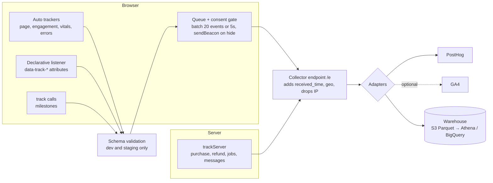

# 11 — Analytics Tracking Plan (user engagement)

**Status:** v1 · **Date:** 25 October 2026 · **Owner:** Product (plan) + Engineering (implementation)
**Replaces:** the event list in `06-observability-and-analytics.md` §4.2. The tools, consent rules and funnels in `06` still apply.

---

## 1. Design principles

1. **Vendor-neutral.** Events and properties are defined once, here. A small adapter sends them to PostHog (our choice), GA4, Mixpanel or a warehouse with no renaming. Where GA4 has a recommended event with the same meaning, we **use GA4's name** (`page_view`, `view_item`, `search`, `share`, `begin_checkout`, `purchase`, `refund`…), so standard e-commerce reports work out of the box.
2. **Few generic events, rich properties.** 39 events cover the whole product. New features usually need **no new event names**, only new property values (e.g. a new `flow_name` or `element_id`).
3. **Three kinds of tracking:**
   - **Automatic:** fired by the tracking library.
   - **Declarative:** HTML `data-track-*` attributes; no code per button.
   - **Milestones:** a handful of explicit calls.
4. **The server is the source of truth for money and jobs.** `purchase`, `refund`, `payment_failed` and render job outcomes are sent by the backend, never trusted from the browser.
5. **Privacy by design.** No names, phone numbers, emails, message text, photos or exact addresses in any event. Consent-gated (DPDP). See §8.
6. **Every event has the same envelope** (§3), so any event can be sliced by language, device, source or festival.

---

## 2. Naming conventions

| Rule | Example |
|---|---|
| Event names: `snake_case`, **verb_object** (GA4 style), present tense | `view_item`, `begin_checkout`, `flow_step` |
| Property names: `snake_case`, nouns | `item_id`, `flow_name`, `element_id` |
| Enumerated values: lowercase `snake_case` | `media_kind: "video"`, `share_method: "whatsapp_file"` |
| Money: `value` as a **decimal in rupees** + `currency: "INR"` (GA4 convention) | `value: 399.00` |
| Durations: `*_ms` integers | `engaged_time_ms: 18250` |
| Booleans: `is_*` / `has_*` | `is_paid: true` |
| IDs: opaque UUIDs only, never phone/email | `user_id: "01JC…"` |
| Versioning: `event_version` (integer) on every event; bump it when the meaning of required properties changes | `event_version: 1` |

---

## 3. Event envelope (sent with every event)

| Property | Type | Required | Description |
|---|---|---|---|
| `event_name` | string | ✔ | From the catalogue in §4 |
| `event_version` | int | ✔ | Schema version of this event |
| `event_id` | uuid (v7) | ✔ | Unique per event; used to drop duplicates |
| `event_time` | ISO-8601 UTC | ✔ | When it happened (client clock for client events) |
| `received_time` | ISO-8601 UTC | (server adds) | When the collector received it |
| `source` | enum `client` \| `server` | ✔ | |
| `anonymous_id` | uuid | ✔ | First-party device ID (cookie/localStorage, 13 months). Before analytics consent, a random per-page ID is sent instead (§7.6) |
| `user_id` | uuid | — | Internal user ID once known (after checkout/login) |
| `session_id` | uuid | ✔ (client) | New after 30 min of inactivity or at midnight IST |
| `session_seq` | int | ✔ (client) | Event counter within the session |
| `page_type` | enum | ✔ (client) | `home`, `collection`, `item`, `editor`, `paywall`, `checkout`, `success`, `recipient`, `event`, `event_manage`, `search`, `seo_text`, `policy`, `other` |
| `page_path` | string | ✔ (client) | Path without the query string; personal slugs replaced (e.g. `/c/:slug`) |
| `referrer_host` | string | — | e.g. `l.wa.me`, `google.com`, `instagram.com` |
| `ui_locale` | enum `hi`/`en`/`mr`/`ta` | ✔ | Interface language |
| `content_locale` | enum | — | Language of the item being viewed or created |
| `platform` | enum `web`/`pwa`/`android_twa` | ✔ | |
| `app_version` | string | ✔ | Build/commit identifier |
| `device_type` | enum `mobile`/`tablet`/`desktop` | ✔ | |
| `device_class` | enum `low`/`mid`/`high` | — | From `navigator.deviceMemory` + CPU cores |
| `os` / `browser` | string | ✔ | Family only (e.g. `android`, `chrome`) |
| `in_app_browser` | enum `whatsapp`/`instagram`/`facebook`/`none`/`other` | ✔ (client) | Critical: much of our traffic opens inside WhatsApp |
| `network_type` | enum `4g`/`3g`/`2g`/`slow-2g`/`unknown` | — | `navigator.connection.effectiveType` |
| `save_data` | bool | — | Data-saver on |
| `country` / `state_code` | string | (server adds) | From IP at the collector; **IP is not stored** |
| `utm_source`, `utm_medium`, `utm_campaign`, `utm_content`, `utm_term` | string | — | First-touch values stored for the session |
| `entry_surface` | enum | ✔ (client) | `seo`, `recipient_link`, `event_link`, `whatsapp_share`, `social`, `paid_ad`, `direct`, `notification`, `referral`, `other` |
| `ref_item_id` | uuid | — | ID of the card/event that brought this visitor (viral attribution) |
| `festival_key` | string | — | Active festival context, e.g. `diwali`, `wedding_season` |
| `experiments` | object | — | `{ "exp_key": "variant" }` for active experiments |
| `consent_analytics` | bool | ✔ | Consent state when the event fired |

### Standard nested objects (reused across events)

**`item`**: anything a user views, creates or buys.

| Field | Example | Notes |
|---|---|---|
| `item_id` | template or card UUID | |
| `item_type` | `template` \| `card` \| `event` \| `pack` | |
| `item_category` | `festival` \| `wish` \| `invitation` \| `business` | |
| `item_subcategory` | `diwali`, `wedding`, `griha_pravesh`, `birthday` | |
| `item_variant` | `mr` | Content language |
| `media_kind` | `image` \| `video` | |
| `tier` | `free`, `premium`, `invite_standard`, `invite_premium` | |
| `price` | `399.00` | Rupees; 0 for free |
| `badges` | `["new","bestseller"]` | Badges actually shown |
| `list_id` / `list_name` | `collection:diwali`, `search`, `recommended` | Where it was shown |
| `position` | `3` | 1-based position in the list |

**`flow`**: any multi-step process.

| Field | Example |
|---|---|
| `flow_name` | `create_card`, `create_invitation`, `checkout`, `rsvp`, `manage_event`, `consent` |
| `flow_id` | UUID per attempt (stays the same across steps) |
| `step_name` | `photo`, `names`, `message`, `event_details`, `style`, `preview`, `contact`, `payment` |
| `step_index` | `2` |
| `entry_point` | `item_page`, `recipient_page`, `resume_draft`, `notification` |

**`element`**: any tracked UI element.

| Field | Example |
|---|---|
| `element_id` | `make_own_cta`, `lang_switch`, `filter_video`, `share_whatsapp` |
| `element_type` | `button`, `link`, `chip`, `tab`, `banner`, `card`, `toggle` |
| `section_id` | `hero`, `grid`, `paywall`, `recipient_cta`, `footer` |
| `position` | 1-based, where relevant |

---

## 4. Event catalogue

Legend. **Src** = source: A (automatic, client library), D (declarative `data-track-*`), C (explicit client call), S (server).

### 4.1 Automatic (no per-feature work)

| Event | Src | Fires when | Key properties |
|---|---|---|---|
| `session_start` | A | First event of a new session | `entry_surface`, `landing_page_type` |
| `page_view` | A | Route change / page load | `page_type`, `page_path`, `item` (on item pages) |
| `page_engagement` | A | Page hidden or route change; sends **foreground** time on the page | `engaged_time_ms`, `scroll_depth_pct` (25/50/75/100), `page_type` |
| `web_vital` | A | LCP/INP/CLS measured (25% sampling) | `metric` (`lcp`/`inp`/`cls`), `value`, `rating` |
| `app_error` | A | Uncaught JS error / failed API call shown to the user | `error_code`, `error_surface`, `http_status`, `is_user_visible` |

### 4.2 Generic interactions (declarative)

| Event | Src | Fires when | Key properties |
|---|---|---|---|
| `ui_click` | D | Tap/click on any element with `data-track-click` | `element` |
| `ui_impression` | D | Element with `data-track-impression` ≥ 50% visible for ≥ 1s, **once per page view** | `element` |
| `form_start` | D | First interaction with a `<form data-track-form="…">` | `form_name` (`checkout_contact`, `rsvp`, `support`, `editor_slots`) |
| `form_submit` | D/C | Form submitted | `form_name`, `outcome` (`success`/`validation_error`/`server_error`), `field_count` |
| `form_error` | D | A validation error is shown | `form_name`, `field_key` (never the value), `error_code` |

### 4.3 Discovery

| Event | Src | Fires when | Key properties |
|---|---|---|---|
| `view_item_list` | C | A collection/search/recommendation list renders (batched impressions) | `list_id`, `list_name`, `items[]` (id, position, tier, badges) |
| `select_item` | C | User taps an item in a list | `item` (incl. `list_id`, `position`) |
| `view_item` | C | Item detail page shown | `item` |
| `search` | C | Search submitted | `search_term` (scrubbed, ≤ 50 chars), `search_script` (`latin`/`devanagari`/`tamil`/`mixed`), `results_count` |
| `preference_update` | C | Language, notification or consent preference changed | `preference` (`ui_locale`, `content_locale`, `notifications`, `consent`), `from`, `to` |

### 4.4 Creation (generic flows)

| Event | Src | Fires when | Key properties |
|---|---|---|---|
| `flow_start` | C | User starts a flow (e.g. opens the editor) | `flow`, `item` |
| `flow_step` | C | User **completes** a step | `flow`, `step_duration_ms`, `step_meta` (e.g. `{has_photo:true, slots_filled:4, used_ready_wish:true}`) |
| `flow_complete` | C | Flow finished successfully (card ready to share; checkout paid; RSVP sent) | `flow`, `total_duration_ms` |
| `flow_abandon` | A | The page is closed or navigated away from with a flow still open, or (sent at the next session start) a flow stayed open for > 30 min | `flow`, `last_step_name` |
| `media_upload` | C | Photo upload finishes or fails | `outcome`, `bytes`, `upload_ms`, `retries`, `source` (`gallery`/`camera`) |
| `preview_view` | C | Preview (watermarked or free) shown | `item`, `latency_ms`, `is_watermarked` |

### 4.5 Sharing, recipients and virality

| Event | Src | Fires when | Key properties |
|---|---|---|---|
| `share` | C | Share action completed (share sheet resolved, or link copied) | `item`, `share_method` (`whatsapp_file`, `whatsapp_link`, `system_share`, `copy_link`, `instagram`, `other`), `is_paid` |
| `file_download` | C | Card/invite file downloaded | `item`, `file_type` (`mp4`/`jpg`/`pdf`) |
| `shared_item_open` | C | A recipient opens a card or event page | `item`, `opener_role` (`recipient`/`owner`/`unknown`), `load_ms` |
| `shared_item_play` | C | Recipient plays the video / turns on sound | `item`, `with_sound` |

The "Make your own" button is a `ui_click` (`element_id: make_own_cta`). The resulting `flow_start` carries `ref_item_id` in the envelope, which is all we need for the viral coefficient.

### 4.6 Commerce

| Event | Src | Fires when | Key properties |
|---|---|---|---|
| `view_offer` | C | Paywall / tier picker shown | `item`, `offers[]` (`offer_id`, `price`, `is_default`, `label` e.g. `recommended`) |
| `select_offer` | C | User picks an option (GA4 adapter maps this to `add_to_cart`) | `item`, `offer_id`, `value`, `currency` |
| `begin_checkout` | C | Checkout page shown with a valid order | `order_id`, `value`, `currency`, `items[]`, `coupon` |
| `add_payment_info` | C | Payment method chosen / gateway opened | `order_id`, `payment_method` (`upi_intent`/`upi_qr`/`card`/`netbanking`/`wallet`), `upi_app` |
| `purchase` | **S** | Payment verified (webhook/server check) | `order_id`, `value`, `currency`, `items[]`, `payment_method`, `gateway`, `time_to_pay_ms`, `is_first_purchase` |
| `payment_failed` | **S** | Gateway reports failure | `order_id`, `value`, `payment_method`, `error_code`, `error_reason` |
| `refund` | **S** | Refund initiated or completed | `order_id`, `value`, `refund_reason`, `refund_status` (`initiated`/`processed`/`failed`), `initiated_by` |

### 4.7 Jobs and notifications (server)

| Event | Src | Fires when | Key properties |
|---|---|---|---|
| `job_complete` | S | Background job succeeded | `job_type` (`render_image`, `render_video`, `render_pdf`, `email_send`, …), `item`, `queue_wait_ms`, `duration_ms`, `priority` |
| `job_failed` | S | Background job failed (final, after retries) | `job_type`, `item`, `error_class`, `attempts` |
| `message_sent` | S | Email/WhatsApp/SMS/push sent | `channel`, `message_type` (`receipt`, `ready`, `refund`, `reminder`, `rsvp_alert`, `view_summary`) |
| `message_open` / `message_click` | C/S | Opened (where measurable) / link clicked (`utm_medium=notification`) | `channel`, `message_type` |

### 4.8 Feedback and experiments

| Event | Src | Fires when | Key properties |
|---|---|---|---|
| `feedback_submit` | C | Rating, CSAT, NPS or "report" submitted | `feedback_type` (`rating`/`csat`/`nps`/`report`), `score`, `item`, `reason_code` |
| `experiment_exposure` | C | User actually sees an experiment variant | `experiment_key`, `variant` |

### 4.9 Premium interest (Phase 0 free launch)

During the free launch (`09` §0), premium features are shown as "coming soon". Interest is measured **with existing events**, so no new event names are needed:

| What | Event | Key properties |
|---|---|---|
| Premium feature seen | `ui_impression` | `element.element_id = premium_teaser`, `section_id` (`editor`, `item_page`, `success`), `item` |
| "Notify me" tapped | `ui_click` | `element.element_id = premium_notify_me`, `item` (invitation template), `section_id` |
| Waitlist joined | `form_submit` | `form_name = premium_waitlist`, `outcome`, `channel` (`email`/`whatsapp`), `consent_marketing = true` |

The contact itself (email or WhatsApp number) is stored in the database with its consent record, **never in analytics**.

**Total: 39 events.** New features should first try to reuse `ui_click`, `flow_*`, `form_*`, `job_*` or `message_*` with new property values before proposing a new event.

---

## 5. Engagement metrics (definitions)

All metrics can be computed from the events above.

| Metric | Definition | Events used |
|---|---|---|
| **Engaged session** | A session with ≥ 10s of foreground time, **or** ≥ 2 `page_view`s, **or** any **key event** | `page_engagement`, `page_view`, key events |
| **Key events** | `flow_complete(create_*)`, `share`, `file_download`, `purchase`, `form_submit(rsvp, success)` | — |
| **Active users (DAU / WAU / MAU)** | Distinct `anonymous_id`s (merged with `user_id` where known) with ≥ 1 engaged session in the period | — |
| **Engagement rate** | Engaged sessions ÷ sessions | |
| **Engaged time per active user** | Σ `engaged_time_ms` ÷ active users | `page_engagement` |
| **Stickiness** | DAU ÷ MAU. Also report **festival-window stickiness** (active days ÷ days in the festival window), since demand is seasonal | |
| **Creator rate** | Users with `flow_start(create_*)` ÷ active users | |
| **Creation completion rate** | `flow_complete` ÷ `flow_start` (per `flow_name`) | |
| **Step drop-off** | For each `step_index`: users reaching step n+1 ÷ users completing step n | `flow_step` |
| **Time to first share** | Median time from `session_start` to the first `share` for new users | |
| **Share rate** | Creators with ≥ 1 `share` or `file_download` ÷ creators who completed a card | |
| **Shares per creator** | `share` count ÷ creators | |
| **Recipient open rate** (link shares only) | `shared_item_open(recipient)` ÷ `share(method ∈ link types)` | |
| **Viral coefficient (K)** | New creators whose `flow_start` has `ref_item_id` ÷ active creators in the same period | |
| **Free → paid conversion** | Users with `purchase` ÷ users with `flow_complete(create_*)` | |
| **Checkout conversion** | `purchase` ÷ `begin_checkout` | |
| **Payment success rate** | `purchase` ÷ (`purchase` + `payment_failed`) per `payment_method` | |
| **ARPU / ARPPU / AOV** | Revenue ÷ active users / ÷ paying users / ÷ orders (net of `refund(processed)`) | |
| **RSVP rate** | `form_submit(rsvp, success)` ÷ unique `shared_item_open` on event pages | |
| **Host return rate** | Event owners with ≥ 2 sessions on `event_manage` within 7 days | |
| **Notify-me rate** (Phase 0) | Invitation creators with `ui_click(premium_notify_me)` ÷ invitation creators with `flow_complete(create_invitation)` | `ui_click`, `flow_complete` |
| **Waitlist conversion** (Phase 0) | `form_submit(premium_waitlist, success)` ÷ `ui_click(premium_notify_me)` | `form_submit`, `ui_click` |
| **Retention (D1 / D7 / D30)** | % of new users with an engaged session on day 1 / 7 / 30 | |
| **Festival-cycle retention** | % of users active in festival window N who are active in window N+1 | |
| **Feature adoption** | % of `flow_complete` where `step_meta` shows the feature was used (photo, ready wish, music change, 2nd language, both family sides) | `flow_step` |
| **Search success** | Searches followed by `select_item` within 60s ÷ searches; no-result rate | `search`, `select_item` |
| **Quality** | Render failure rate (`job_failed` ÷ all jobs); p95 `duration_ms`; user-visible `app_error` per 1,000 sessions; LCP p75 by `in_app_browser` | |

---

## 6. Launch KPIs (first 4 weeks after go-live)

Targets are **assumptions [A]**. Review them weekly and reset after the first full season.

| KPI | Target |
|---|---|
| Weekly shared items (north star) | Grows week on week |
| Creation completion rate (`create_invitation`) | ≥ 55% |
| Share rate | ≥ 70% |
| Free → paid (invitations) | ≥ 8% |
| Checkout conversion | ≥ 60% |
| Payment success rate | ≥ 85% |
| Render failure rate | ≤ 1% |
| Notify-me rate among invitation creators (Phase 0; part of the switch-on rule in `09` §0) | ≥ 3% |
| Viral coefficient K | ≥ 0.10 |
| RSVP rate on event pages | ≥ 30% |
| Recipient page LCP p75 (WhatsApp in-app browser) | ≤ 2.0s |

---

## 7. Implementation guide

### 7.1 Architecture



- **A first-party collector** (`/e` on our domain): ad blockers rarely break it, the IP can be dropped, and the backend can switch vendors with no change to the client code.
- **One tracking plan file** (`analytics/tracking-plan.yaml`) is the source of truth. TypeScript types and runtime validators (zod) are **generated** from it, so `track('shre', …)` fails at compile time.

### 7.2 Client API (TypeScript sketch)

```ts
// analytics/track.ts
type Envelope = {
  event_name: EventName; event_version: number; event_id: string; event_time: string;
  source: 'client'; anonymous_id: string; user_id?: string; session_id: string; session_seq: number;
  page_type: PageType; page_path: string; ui_locale: Locale; content_locale?: Locale;
  platform: 'web' | 'pwa' | 'android_twa'; app_version: string; device_type: DeviceType;
  in_app_browser: InAppBrowser; entry_surface: EntrySurface; ref_item_id?: string;
  consent_analytics: boolean; experiments?: Record<string, string>;
};

export function track<E extends EventName>(name: E, props: EventProps[E]): void {
  const event = { ...buildEnvelope(name), ...props };
  if (process.env.NODE_ENV !== 'production') validate(name, event); // generated zod schema
  if (!consent.analytics && !ESSENTIAL_EVENTS.has(name)) return; // DPDP gate
  queue.push(scrubPII(event));                               // batch + sendBeacon
}

// Declarative: one delegated listener covers every tracked button/link.
document.addEventListener('click', (e) => {
  const el = (e.target as HTMLElement).closest<HTMLElement>('[data-track-click]');
  if (!el) return;
  track('ui_click', { element: {
    element_id: el.dataset.trackClick!, element_type: el.dataset.trackType ?? 'button',
    section_id: el.dataset.trackSection ?? 'unknown',
    position: el.dataset.trackPosition ? Number(el.dataset.trackPosition) : undefined,
  }});
}, { capture: true });
```

```html
<!-- No code needed per element -->
<a href="/hi/create/…" data-track-click="make_own_cta" data-track-section="recipient_cta">
  अपना कार्ड बनाएं →
</a>
<section data-track-impression="trust_strip" data-track-section="paywall">…</section>
```

### 7.3 Server API

```ts
// Called from the payments webhook handler after verification
trackServer('purchase', {
  user_id, anonymous_id, // anonymous_id stored on the order at checkout
  order_id, value: 399.0, currency: 'INR', payment_method: 'upi_intent', gateway: 'razorpay',
  items: [{ item_id, item_type: 'card', item_category: 'invitation', item_subcategory: 'wedding',
            item_variant: 'mr', media_kind: 'video', tier: 'invite_premium', price: 399.0 }],
  time_to_pay_ms: 41250, is_first_purchase: true,
});
```

### 7.4 Example payload

```json
{
  "event_name": "flow_step",
  "event_version": 1,
  "event_id": "01JBF6N8Y3W6T2C2Q4C9V7M5ZK",
  "event_time": "2026-11-14T05:12:44.120Z",
  "source": "client",
  "anonymous_id": "5f0d1c2e-7a41-4c8e-9a36-1f2b3c4d5e6f",
  "session_id": "0b8d7c6e-1234-4f5a-9b8c-7d6e5f4a3b2c",
  "session_seq": 14,
  "page_type": "editor",
  "page_path": "/mr/create/:draft_id",
  "ui_locale": "mr",
  "content_locale": "mr",
  "platform": "web",
  "app_version": "2026.11.14-3f2a1c",
  "device_type": "mobile",
  "device_class": "low",
  "in_app_browser": "whatsapp",
  "entry_surface": "recipient_link",
  "ref_item_id": "a1b2c3d4-0000-4000-8000-000000000001",
  "consent_analytics": true,
  "flow": { "flow_name": "create_invitation", "flow_id": "7c9e…", "step_name": "event_details", "step_index": 3, "entry_point": "recipient_page" },
  "step_duration_ms": 52310,
  "step_meta": { "functions_count": 4, "has_both_sides": true, "has_qr": false }
}
```

### 7.5 Identity
- **`anonymous_id`:** created on first visit, stored in a first-party cookie + localStorage, lasts 13 months.
- **`user_id`:** set once known (checkout or login). The adapter calls the vendor's `identify` to merge the anonymous history.
- **Server events** carry the `anonymous_id` saved on the order, so web and server events join correctly.
- **Recipients are never identified.** Their events carry only their own `anonymous_id` and `ref_item_id`.

### 7.6 Consent and PII (DPDP)
- **Before analytics consent:**
  - Only **essential, anonymous** events are sent: `page_view`, `app_error` and `web_vital`, with no `anonymous_id` (a random per-page ID instead), and `preference_update(consent)`.
  - No vendor cookies; the collector aggregates these.
- **After consent:** the full plan.
- **Withdrawal:** stops tracking immediately and deletes the `anonymous_id`.
- **Never send:** names, phone numbers, emails, message/wish text, venue addresses, photos or their URLs, UPI IDs, search terms containing digit runs ≥ 6 or an `@` (scrubbed to `[redacted]`), card/event public slugs (replaced by item IDs).
- `scrubPII()` runs on every event, and the collector runs it again as a second line of defence.

### 7.7 Delivery and reliability
- Batch: 20 events or 5s, whichever comes first.
- `navigator.sendBeacon` on `visibilitychange: hidden` (important in the WhatsApp in-app browser, where users leave abruptly).
- Retry with backoff; drop after 24h.
- The collector removes duplicates by `event_id`.
- Sampling: `web_vital` at 25%. Everything else at 100%.

### 7.8 QA and acceptance
- [ ] Every event in the plan is triggered in staging and visible in the vendor's debug view with every **required** property.
- [ ] CI check: every `track()` name exists in `tracking-plan.yaml` (generated types).
- [ ] An automated E2E test (Playwright) runs the core journeys (browse → create → share; create → pay → download; recipient → make own; RSVP) and asserts the expected event sequence at the collector.
- [ ] A PII test: the E2E run enters a known name, phone and message, and asserts none of them appear in any captured payload.
- [ ] Server `purchase` totals reconcile with the Razorpay dashboard daily (difference = 0).

### 7.9 Governance
- **Owner:** the founder/PM approves changes; engineering implements.
- **Change process:** a PR to `tracking-plan.yaml` (+ a changelog line) → generated types → implementation → QA checklist.
- **Deprecation:** mark an event `deprecated` with a removal date. Keep it in the plan for 90 days.
- **Retention:** raw events 13 months; aggregates kept indefinitely.

---

## 8. Dashboards (built on day 1)

| Dashboard | Contents |
|---|---|
| **Engagement overview** | DAU/WAU/MAU, engaged sessions, engagement rate, engaged time, stickiness, by `ui_locale`, `in_app_browser`, `entry_surface` |
| **Creation funnel** | `view_item` → `flow_start` → each `flow_step` → `flow_complete` → `share`, per `flow_name` and language |
| **Viral loop** | Shares → recipient opens → `make_own_cta` clicks → new creators; K by template and language |
| **Revenue** | `view_offer` → `select_offer` → `begin_checkout` → `add_payment_info` → `purchase`; payment success by method/UPI app; refunds |
| **Invitations** | Invitations created, RSVP rate, host return rate, functions per event, both-sides adoption |
| **Quality** | Render p95 and failures, user-visible errors, LCP p75 by in-app browser and device class |

---

## 9. Mapping from the previous event list (`06` §4.2)

| Old (06) | New (this plan) |
|---|---|
| `page_viewed` | `page_view` |
| `language_selected` | `preference_update(preference=ui_locale)` |
| `festival_hero_clicked` | `ui_click(element_id=festival_hero)` |
| `collection_viewed` / `template_impression` | `view_item_list` |
| `template_viewed` | `view_item` |
| `search_performed` / `search_no_results` | `search` (`results_count = 0`) |
| `editor_started` | `flow_start(create_card / create_invitation)` |
| `slot_filled` | `flow_step` (`step_meta`) |
| `photo_uploaded` | `media_upload` |
| `ai_wish_requested` / `ai_wish_used` | `ui_click(element_id=ai_wish)` + `flow_step.step_meta.used_ai_wish` |
| `preview_generated` | `preview_view` |
| `paywall_viewed` / `paywall_option_selected` | `view_offer` / `select_offer` |
| `otp_requested` / `otp_verified` | `form_start` / `form_submit(form_name=otp)` |
| `checkout_started` | `begin_checkout` |
| `payment_method_selected` | `add_payment_info` |
| `payment_succeeded` / `payment_failed` | `purchase` / `payment_failed` |
| `render_completed` / `render_failed` | `job_complete` / `job_failed(job_type=render_*)` |
| `card_shared` / `card_downloaded` | `share` / `file_download` |
| `recipient_page_viewed` | `shared_item_open` |
| `recipient_make_own_clicked` | `ui_click(element_id=make_own_cta)` |
| `wishes_sent_back` | `form_submit(form_name=reply)` |
| `rsvp_submitted` | `form_submit(form_name=rsvp)` |
| `refund_initiated` / `refund_completed` | `refund(refund_status=initiated/processed)` |
| `reminder_opt_in` / `notification_clicked` | `preference_update(notifications)` / `message_click` |
| `rating_submitted` | `feedback_submit(feedback_type=rating)` |
