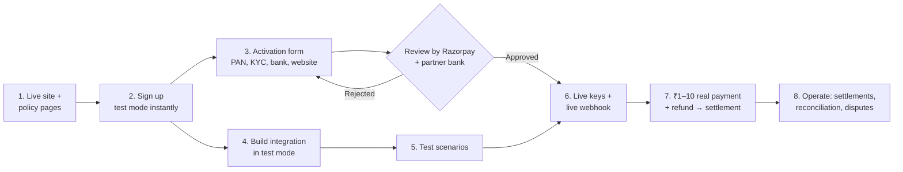

# 12 — Business Setup: Entity, Razorpay and GST

**Status:** v1 · **Owner:** Founder · **For:** CardReel (`cardreel.in`)
**Not legal or tax advice.** Researched from public sources (listed at the end). Items marked **[CA]** should be confirmed in a 30-minute consultation with a chartered accountant (~₹1–2k).

**Summary**
- **No company is needed to start.** Begin as an individual. Become a sole proprietorship once sales start. Incorporate a Pvt Ltd only for funding or a co-founder.
- **Razorpay** needs a **live website with policy pages** before it issues live keys. Test mode works immediately, so integration can be built in parallel.
- **GST is not needed at the start** while service turnover stays under ₹20 lakh a year, selling from our own website.

---

## 1. Entity and bank account

### 1.1 Recommended path

| Stage | Structure | What you need | When |
|---|---|---|---|
| **Now** | **Individual** (unregistered) on Razorpay | Personal PAN; identity and address via CKYC, or video KYC if CKYC fails; a bank account in your name | Phase 0 / Phase 1 start |
| **First 1–3 months of sales** | **Sole proprietorship** (no incorporation needed) | **Two business proofs.** Razorpay accepts e.g. Udyam (MSME), GST, Shop & Establishment, IEC, or a postpaid mobile bill. Plus a **current account** in the business name | Once revenue starts |
| **Later** | **Private Limited company** | ~₹7–25k to set up; ~₹20k–1.5 lakh a year in compliance; yearly audit and filings | Only to raise investment, add a co-founder, or limit personal liability |

### 1.2 Practical notes
- **Video KYC:** if your KYC records can't be fetched automatically, Razorpay runs a video call. You must show your **original physical PAN card**. Printouts, screenshots and e-PAN on a phone are **not accepted**.
- **Udyam registration** is free on the government portal (`udyamregistration.gov.in`), takes about 10 minutes with an Aadhaar OTP, and never expires. Don't pay agents for it.
- **Shop & Establishment registration** is a state-level licence from your state's labour department portal. It's a common second business proof.
- **Bank account:**
  - Use an account **only for this business**.
  - Some banks don't allow business use of savings accounts and may question frequent business credits. Mixing personal and business money also complicates taxes.
  - Move to a **current account** once you're a proprietorship.
  - I couldn't confirm whether Razorpay settles to a *savings* account for individuals. Check this on the activation screen.
- **Name match:** the name on your **PAN**, **bank account**, **domain registration** and the website's "operated by" line must match. A mismatch is a common reason for rejection.
- **Income tax:** business income goes in your **personal tax return**. Small businesses with mostly digital receipts can usually use the **presumptive taxation scheme** (a fixed share of turnover counted as profit). Sections were renumbered under the Income-tax Act, 2025 **[CA]**.
- **Liability:** an individual or proprietorship has no legal separation from your personal assets. Good terms, a clear refund policy and automatic refunds reduce the risk.

---

## 2. Razorpay: from onboarding to live payments

### 2.1 Overview

### 2.2 Steps and who does what

| # | Step | Who | Details |
|---|---|---|---|
| 1 | **Live website + policy pages** | Claude builds, you review | Razorpay's automated checks look for **About us, Contact us, Pricing, Terms and conditions, Privacy policy, Cancellation/Refund policy**. We also add a **Delivery policy** for digital goods: delivered instantly, nothing shipped. The site must look finished: HTTPS, real templates, no placeholder text. Premium prices may be marked "coming soon" |
| 2 | **Sign up** | You | Email + phone. **Test mode is available immediately**, so development doesn't wait for approval |
| 3 | **Activation form** | You | Business type **Individual**. Personal PAN → KYC record lookup (OTP) or video KYC. Bank account (verified with a small test deposit). Website URL. Category: digital goods/services |
| 4 | **Build the integration (test mode)** | Claude | See §2.3 |
| 5 | **Test scenarios** | Claude + you | Success, failure, user closes checkout, duplicate webhook, refund, webhook outage (retry), UPI pending |
| 6 | **Go live** | You enter keys, Claude switches config | Generate **live API keys** and a **live webhook** with its own secret. You enter them in AWS SSM Parameter Store; never paste secrets into chat |
| 7 | **First real transaction** | You | Pay ₹1–10, refund it, and confirm the settlement reaches your bank |
| 8 | **Operate** | Both | Settlements, daily reconciliation, refund tracking, dispute (chargeback) responses within the gateway's deadlines (`05`) |

### 2.3 Integration (what Claude builds)
1. **Create an order on the server** for every payment, using the Orders API. The amount is in **paise** (₹399 → 39900). The **key secret stays on the server**; the browser only gets the public key ID.
2. **Open Standard Checkout** in the browser with the key ID, order ID, prefilled phone/email, and CardReel branding. On mobile, **UPI intent** opens the customer's UPI app; on desktop, a QR code is shown.
3. **Verify the payment signature on the server:** `HMAC_SHA256(our_stored_order_id + "|" + payment_id, key_secret)`. Use **our own stored order ID**, never the one the browser sends back.
4. **Webhooks** are the source of truth.
   - Events: `payment.captured`, `payment.failed`, `order.paid`, `refund.created`, `refund.processed`, `refund.failed`.
   - Verify `X-Razorpay-Signature` against the **raw request body** using the **webhook secret**. This is a different secret from the API key secret.
   - De-duplicate using the **`x-razorpay-event-id`** header.
   - Handle events arriving **out of order**.
5. **Auto-capture** is turned on in the dashboard.
6. **Refunds** go through the Refunds API (`speed: optimum` for instant refunds where possible). Auto-refund when a render fails (`05` §3).
7. **Status-check fallback:** if neither the browser callback nor a webhook arrives, the server asks Razorpay for the payment status (sweeper every minute for pending orders).
8. **Logs and alerts:** every payment and webhook event is logged, with email alerts on payment-failure spikes and refund failures (`06`).

### 2.4 Timelines and fees **[verify on Razorpay's live pricing page at signup]**
- **Activation:**
  - **Minutes** when your KYC records already exist and can be fetched automatically.
  - **24–48 hours** per Razorpay's quickstart.
  - **2–4 business days** in third-party reports.
  - A **partner bank gives the final approval.**
- **Fees:** about **2% + 18% GST on the fee** on the standard plan.
  - Several sources say the platform fee also applies to **UPI**, even though UPI's own bank charge (MDR) is zero.
  - Razorpay has advertised a **0% platform fee for the first 90 days** for new merchants; check eligibility.
- **Settlement:** sources disagree between **T+1 and T+2** working days. Instant settlement is a paid add-on.
- **Common rejection reasons:**
  - missing policy pages;
  - an unfinished or placeholder site;
  - **names that don't match** across PAN, bank account and website;
  - a restricted business category.

---

## 3. GST

### 3.1 Do we need it now? **No**, as long as all of these hold **[CA]**
1. **Turnover:** all-India turnover from services stays **≤ ₹20 lakh** a financial year (**₹10 lakh** in certain special-category states; check which applies to you).
2. **What we sell:** e-cards and video invitations are **services** under GST (digital content), not goods.
3. **How we sell:** **from our own website**, not through a marketplace that collects the money for us. Razorpay is a payment gateway, **not** an e-commerce operator.

### 3.2 Why the common online warnings don't apply
- **"Selling across states forces registration."** True for **goods**. For **services**, **Notification 10/2017-Integrated Tax** exempts suppliers under the threshold, even when they sell to other states.
- **"Online services must always register (OIDAR)."** **Section 24(xi)** of the CGST Act applies only to suppliers **located outside India** serving users in India. Indian suppliers follow the normal ₹20 lakh threshold.

### 3.3 What changes without GST
- We **don't charge GST** and don't show a GST number. Receipts are simple bills, not tax invoices.
- We **can't reclaim** the GST we pay on Razorpay fees, hosting and similar costs (small amounts).

### 3.4 When to register
- **Mandatory:** within **30 days** of crossing the threshold. **Start the process at ~₹15 lakh** run-rate.
- **Voluntary, earlier:** if corporate (B2B) customers need GST invoices, or if you want GST as the second business proof for a proprietorship.
- **What registration means:** charging **18% GST** on our services, filing returns (quarterly filing is available for small taxpayers), and issuing tax invoices plus **credit notes for refunds**. The low-rate composition scheme for services **doesn't allow selling to other states**, so it doesn't suit us.
- **Pricing tip:** when GST starts, **keep the displayed price the same** (e.g. ₹399 "incl. GST") and absorb the ~15% rather than raising prices. The price-honesty rules in `03` stay intact.

---

## 4. Checklist for the CA consultation
1. Confirm the GST threshold for your state, and that our service and sales model fit the ₹20 lakh limit plus Notification 10/2017-IGST.
2. Starting as an individual with a dedicated account (savings vs current).
3. Whether the presumptive tax scheme applies, and the record-keeping needed.
4. When to register as a proprietorship (Udyam + Shop & Establishment) and open a current account.
5. GST invoices and credit notes once registered.

---

## Sources
- Razorpay: [Minimum documents by business type](https://razorpay.com/blog/minimum-documents-payment-gateway-onboarding-india/) · [FAQs](https://razorpay.com/docs/payments/faqs/?preferred-country=IN) · [Video KYC](https://razorpay.com/blog/video-kyc-payment-gateway-onboarding-india/) · [Business website details](https://razorpay.com/docs/payments/dashboard/account-settings/business-website-details/?preferred-country=US) · [Faster onboarding 2026](https://razorpay.com/blog/faster-payment-gateway-onboarding-india/) · [Test mode vs live approval](https://razorpay.com/blog/instant-payment-gateway-activation-india/) · [Quickstart](https://razorpay.com/docs/us/payments/quickstart)
- Razorpay integration: [Integration steps](https://razorpay.com/docs/us/payments/payment-gateway/web-integration/standard/integration-steps) · [Payment webhooks](https://razorpay.com/docs/us/webhooks/payments) · [Order webhooks](https://razorpay.com/docs/us/webhooks/orders) · [Refund webhooks](https://razorpay.com/docs/webhooks/refunds/) · [Validate and test webhooks](https://razorpay.com/docs/us/webhooks/validate-test) · [Hookdeck guide](https://hookdeck.com/webhooks/platforms/guide-to-razorpay-webhooks-features-and-best-practices)
- Razorpay pricing: [Pricing explained](https://razorpay.com/blog/razorpay-payment-gateway-pricing-explained/) · [0% fee offer](https://razorpay.com/blog/razorpay-0-percent-platform-fee-offer-90-days-new-merchants-2026/) · [Xflowpay comparison](https://www.xflowpay.com/blog/payment-gateway-charges-comparison)
- GST: [Notification 10/2017-IGST](https://gstlearn.com/2017/11/15/integrated-tax-notification-102017-seeks-to-exempt-persons-making-inter-state-supplies-of-taxable-services-from-registration-under-section-232/) · [Section 24 compulsory registration](https://taxguru.in/goods-and-service-tax/compulsory-gst-registration-section-24-cgst-act-2017.html) · [OIDAR domestic supplier discussion](https://www.caclubindia.com/forum/gst-registration-for-oidar-589293.asp) · [Cashfree: GST for online sellers](https://www.cashfree.com/blog/gst-to-sell-online/) · [GST thresholds](https://taxclue.in/guide/gst-registration-threshold)
- Entity and bank: [Proprietorship vs Pvt Ltd compliance](https://www.kanakkupillai.com/learn/annual-compliance-comparison-opc-vs-private-limited-company-vs-llp-vs-sole-proprietorship/) · [Annual compliance costs 2026](https://www.incorpx.io/blog/annual-compliance-cost-startups-2026) · [Savings account for business income](https://sudhirrao.com/using-personal-savings-account-for-business-income-in-india-is-it-risky/) · [Kotak: current vs savings](https://www.kotak.bank.in/en/stories-in-focus/accounts-deposits/current-account/current-account-vs-savings-account-for-business.html) · [Udyam registration is free](https://tallysolutions.com/business-guides/what-is-udyam-and-steps-for-registration/)
