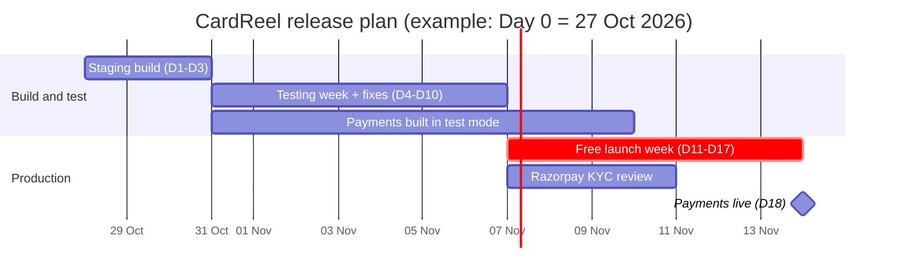

# 15 — Release Plan: Staging → Free Launch → Payments

**Status:** v1 · **Owner:** Founder (decisions, testing, KYC, marketing) + Claude (build, fixes, deploys)
**Founder's timeline:**
1. **Staging live within 2–3 days** of the PRD go-ahead.
2. **About a week of testing.**
3. **Production live, free, for the first week.**
4. **Payments live one week after that.**

**Day 0 = the day the founder confirms the PRD.** All dates below are relative. The example column assumes **Day 0 = Tue 27 Oct 2026**.

**Assumption to confirm:** Phase 1 sells **only premium invitations** (₹199 Standard / ₹399 Premium). Greetings and image invites stay free (`14` §F3). Selling one product is what makes "payments in one week" realistic.

---

## 1. Timeline

| Stage | Days | Example dates | Goal | Exit gate |
|---|---|---|---|---|
| **0. Go-ahead** | D0 | Tue 27 Oct | PRD confirmed; accounts and domain ready | Checklist §4 done |
| **1. Staging build** | D1–D3 | 28–30 Oct | Core free flows working on `staging.cardreel.in` | Staging entry criteria (§3.1) |
| **2. Testing week** | D4–D10 | 31 Oct – 6 Nov | Test, fix, add templates; build payments in **test mode** in parallel | **Go/no-go for production** (§3.2) |
| **3. Production, free** | D11–D17 | **Sat 7 Nov** – Fri 13 Nov | Public launch on `cardreel.in`, free; submit Razorpay KYC; marketing starts | **Go/no-go for payments** (§3.3) |
| **4. Payments live** | D18 | **Sat 14 Nov** | Premium invitations on sale | Live ₹1 payment + refund verified |

**Why these dates work:**
- **Before Diwali:** production goes live **the day before Diwali** (8 Nov), with Bhai Dooj (10–11 Nov) and Chhath (13–16 Nov) in the free week.
- **Wedding season:** payments open around **14 Nov**, when invitations for the **2–12 Dec weddings** go out.
- **Slip rule:** if Day 0 slips by N days, everything slips by N days. **The free launch can slip past Diwali without harm.** The payments date should hold for the December wedding wave, even if the free week becomes shorter.

---

## 2. Environments

| | **Local** (Claude's workspace) | **Staging** `staging.cardreel.in` | **Production** `cardreel.in` |
|---|---|---|---|
| Purpose | Build and unit test | Testing week; design partners; payment tests | Real users |
| AWS | — | Staging stack (ideally a separate staging account) | Production stack (production account) |
| Access | — | **Private:** CloudFront basic-auth function (shared tester password) + `noindex` | Public |
| Website | Next.js dev server | S3 + CloudFront, deployed from the `staging` branch | S3 + CloudFront, deployed from `main` |
| API | Local functions | API Gateway + Lambda (staging) | API Gateway + Lambda (prod) |
| Database | Local DynamoDB | DynamoDB tables (staging) | DynamoDB tables (prod), point-in-time recovery on |
| Render worker | Local FFmpeg + Chromium | SQS + render Lambda (staging) | SQS + render Lambda (prod) |
| Media storage | Local | S3 bucket `cardreel-staging-media` | S3 bucket `cardreel-prod-media` |
| Payments | — | **Razorpay test mode** (works before KYC) | Live keys **from D18 only** |
| Analytics / errors | Off | PostHog + Sentry, environment `staging` | PostHog + Sentry, environment `production` |
| Email | Logged only | SES (sandbox: verified testers only) | SES (production access) |
| Data | Sample | Test data; **wiped before production launch** | Real |

Stack details: `16-stack-accounts-email.md`. All infrastructure is defined in **AWS CDK** and deployed by **GitHub Actions**.

**Rules:**
- **Secrets are never shared between environments.** Keys live in AWS SSM Parameter Store per environment; you enter them yourself. Never paste them in chat.
- **Changes move one way:** local → staging → production. Production deploys only from `main`, after staging passes.
- **Fast rollback:** redeploy the previous build from GitHub Actions (static site and Lambda versions are kept).
- **Feature switches, flipped without a deploy:** `payments_enabled`, `video_render_enabled`, `free_video_daily_cap`.

---

## 3. Gates

### 3.1 Staging entry criteria (end of D3)
These must work on `staging.cardreel.in`:
- [ ] Home, collections and template pages in **4 languages** (UI strings may still be under review).
- [ ] **Invitation editor** with the Indian content model: inviting family, names, date/time/venue, functions, photo, header symbol, music.
- [ ] **Greeting editor** (names, photo, ready-written wishes).
- [ ] **Rendering:** image, video (≤ 60s, 9:16) and PDF, with the free branding (corner logo + 2s end card).
- [ ] **Sharing:** WhatsApp file share, link share, download; recipient page and event page with "Make your own".
- [ ] **Starter catalogue:** 4 wedding invites, 2 griha pravesh invites, 4 greetings (more added during testing week).
- [ ] **"Premium — coming soon" + "Notify me"**, with consent.
- [ ] **Policy pages:** About, Contact, Pricing, Terms, Privacy, Cancellation/Refund, Delivery, FAQ.
- [ ] Analytics core events and Sentry reporting.

### 3.2 Go/no-go for production (end of D10)
**All** must pass:
- [ ] **No P0/P1 bugs open** (definitions in §5.2).
- [ ] **Render reliability:** ≥ 99% success on 200 test renders across all live templates; video p95 ≤ 60s.
- [ ] **Speed:** recipient page LCP ≤ 2.5s on a low-end Android **inside WhatsApp** on 4G.
- [ ] **Native review signed off** for every live Hindi, Marathi and Tamil template and the UI strings. A language whose review isn't done launches with English UI only for that language.
- [ ] **Usability:** ≥ 4 of 5 testers make and send a wedding invite in under 6 minutes without help.
- [ ] **Launch catalogue live:** 8 wedding/engagement video invites, 6 image invites, 4 griha pravesh invites, 6 greetings (Bhai Dooj, Chhath, birthday), 30 ready-written wishes per language.
- [ ] **Licensed music** in place for every video template.
- [ ] **Abuse controls on:** Turnstile, free video cap (5 per device per day), upload checks.
- [ ] **Analytics QA** passed (`11` §7.8). Server-side counters for renders, shares, completions and waitlist sign-ups (`14` §F7).
- [ ] **Staging data wiped;** production secrets set; domain, HTTPS and email (SPF/DKIM/DMARC) verified.
- [ ] **Support ready:** FAQ live; WhatsApp Business auto-reply; "Send to myself on WhatsApp" for manage links.

### 3.3 Go/no-go for payments (end of D17)
**All** must pass:
- [ ] **Razorpay KYC approved** and live keys issued. Submit KYC **on D11**, once the full production site is public. Razorpay checks for a finished site, so a placeholder page risks rejection.
- [ ] **Payment tests passed in staging (test mode)** (§5.1, P-1 to P-9).
- [ ] **Premium features tested:** both family sides, multi-function event page + RSVP, no branding, HD + PDF, 14-day edits.
- [ ] **Production smoke test:** a live **₹1** test product purchase and full refund, with the settlement visible in the Razorpay dashboard.
- [ ] **Payment alerts emailing the founder:** payment-failure spike, refund failure, paid-but-not-delivered (`06` §3).
- [ ] **Policies updated** with the final prices; receipt email checked.
- [ ] **Free week health:** no open P0/P1; render success ≥ 99% in production.

**If KYC isn't approved by D17:** stay free, keep collecting the waitlist, and switch on payments the day approval arrives (`payments_enabled`). Nothing else changes.

---

## 4. Founder checklist by stage

| When | Founder does |
|---|---|
| **D0** | Confirm the PRD. Buy `cardreel.in` (registrant name = PAN name). Create accounts (`16` §5): **AWS** (MFA, admin user, Mumbai region, Budgets alerts), GitHub, Cloudflare (Turnstile + DNS), PostHog, Sentry, Razorpay (sign up only), **Zoho Mail Free**. Reserve @cardreel handles |
| D1–D3 | Run the AWS CloudShell bootstrap script Claude provides. **Request SES production access** and check the Lambda quota. Add keys to SSM when asked. Confirm the music source. Line up **5 usability testers** and **8–12 design-partner families** (`14` §F4). Line up **Marathi and Tamil reviewers** |
| D4–D10 | Run the 5 usability sessions (script in §5.3). Do the device tests. Native reviewers check templates and UI. Design partners try staging. Daily 15-minute bug triage with Claude. Approve the launch catalogue |
| **D10** | Go/no-go for production (§3.2) |
| D11 | Launch posts (WhatsApp, Instagram). **Submit Razorpay KYC.** Start vendor partnerships (`14` §F5) |
| D11–D17 | Answer support. Watch the dashboard daily. Approve fixes. Test the premium features in staging |
| **D17** | Go/no-go for payments (§3.3) |
| D18 | Announce premium. Email the waitlist (consented contacts only) |

**Founder time:** about **4–5 hours a day** in the testing week and the free week **[E]**.

---

## 5. Test plan (testing week)

### 5.1 What gets tested

| Area | Tests | Who |
|---|---|---|
| **Core flows** | Browse → template → personalise → preview → render → share/download, for greetings and invitations in each language | Claude (automated end-to-end tests) + founder |
| **Invitation content** | Both family sides; long names; many relatives; 4+ functions; each header symbol; bilingual text | Founder + native reviewers + design partners |
| **Indic text** | Correct letter shaping in Hindi, Marathi and Tamil in the preview **and** the final video/image/PDF; Marathi-specific letter forms; long-name auto-shrink | Native reviewers |
| **Devices** | Low-end Android (Chrome + **WhatsApp in-app browser**), mid-range Android, iPhone (Safari + WhatsApp), desktop Chrome | Founder |
| **WhatsApp output** | Video plays in chat and Status; text readable after WhatsApp compression; link preview shows title and image; "no app needed" text | Founder |
| **Rendering load** | 200 renders across templates; 20 at once (light load test); queue message when busy; daily cap | Claude |
| **Speed** | LCP / INP on the home, template, recipient and event pages, measured on a throttled 4G connection | Claude |
| **Security** | Upload checks (type, size, image cleaning), Turnstile, rate limits, allowlisted links only, private pages not in search results, security headers | Claude |
| **Privacy and consent** | Consent banner; notify-me consent; delete-my-data request; children's-photo notice | Claude + founder |
| **Analytics** | Every event in `11` fires with its required properties; no personal data in payloads | Claude |
| **Payments (test mode)** | **P-1** success by UPI/card/net banking · **P-2** failed payment, retry keeps the card · **P-3** user closes checkout · **P-4** UPI pending, then success · **P-5** duplicate webhook ignored · **P-6** webhook missing, status check recovers · **P-7** render fails 3 times → automatic refund + email · **P-8** manual refund from the dashboard · **P-9** receipt email and manage link · plus the automated concurrency tests **C-1 to C-16** (`17` §6.4, §13) | Claude + founder |

### 5.2 Bug severity

| Severity | Meaning | Rule |
|---|---|---|
| **P0** | Can't create or share; data leak; wrong charge or no refund | Blocks launch; fix the same day |
| **P1** | A core flow is broken for one language/device; text renders wrongly in output | Blocks launch |
| **P2** | Workaround exists; visual flaws | Fix during the free week |
| **P3** | Polish | Backlog |

Bugs are tracked as GitHub issues, labelled by severity and area.

### 5.3 Usability test script (5 sessions, 20 minutes each)
1. **Setup:** a low-end Android phone with WhatsApp. Send the tester the staging link in WhatsApp.
2. **Task A:** "Make a wedding invitation for your cousin's wedding on 2 December, with both families' names, and send it to a WhatsApp group."
3. **Task B:** "Make a Bhai Dooj greeting with your photo and send it to your brother."
4. **Watch for:** where they hesitate, what they misread, and whether they find the share button and the "Make your own" button.
5. **Ask afterwards:** "Would you send this to your family? What would make you pay ₹199 for it?"
6. **Pass:** ≥ 4 of 5 finish Task A in under 6 minutes without help.

---

## 6. Launch-week operations

| Item | Plan |
|---|---|
| **Monitoring** | Daily: Sentry errors, render failures and queue age, PostHog funnel, waitlist count, support messages. Email alerts for render failures (and payment/refund failures from D18) |
| **Release rhythm** | Fixes go to staging first, then production daily at a quiet hour (late evening IST). No deploys in the 2 hours after a big post |
| **Rollback** | Redeploy the previous build from GitHub Actions; switch off a broken template or `video_render_enabled` without a deploy |
| **Support** | WhatsApp Business + support@cardreel.in; reply within 24 hours; FAQ updated from repeated questions |
| **Daily metrics** | Visitors, creators, completion rate, shares, recipient → creator, notify-me taps, waitlist sign-ups, render success |

---

## 7. Risks to this timeline

| Risk | Impact | Mitigation |
|---|---|---|
| Day 0 slips | Free launch misses Diwali | Acceptable. Bhai Dooj, Chhath and wedding invites still matter. Protect the payments date for the December wedding wave |
| 3-day staging build is tight | Staging starts thin | Staging entry criteria are a thin slice. Templates and polish continue in the testing week |
| Native review is late | A language can't launch | That language launches with English UI and reviewed templates only (§3.2) |
| Template quality is below competitors | Low completion and no paid demand | Side-by-side check in the testing week. ₹10–20k for 3–5 hero designs (`14` §F6) |
| KYC is delayed or rejected | Payments slip | Submit on D11 with a complete site; fix and resubmit fast; `payments_enabled` stays off until approved |
| Music licence not ready | Video templates can't ship | Source confirmed by D3 |
| Founder capacity | Testing and support suffer | Fixed daily triage slot; vendor partnerships can start in week 2 |
| SES production access is slow | Emails reach only verified testers | Request on D1–D3; until approved, staging uses verified tester addresses |
| Low Lambda concurrency quota on a new account | Renders queue up at launch | Check on D1; request an increase early |
