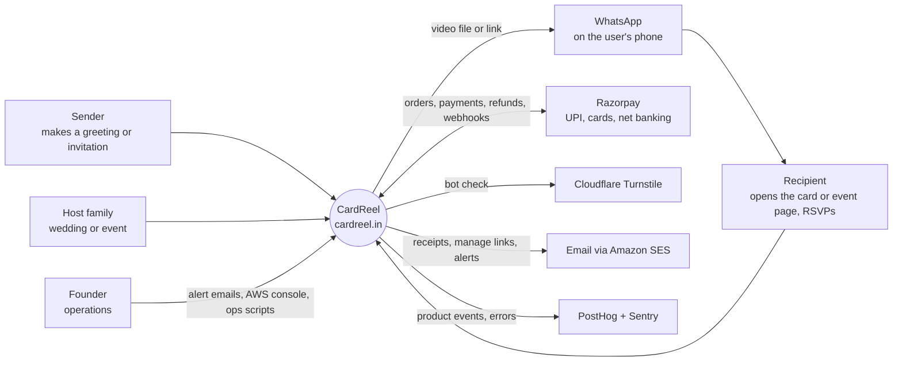
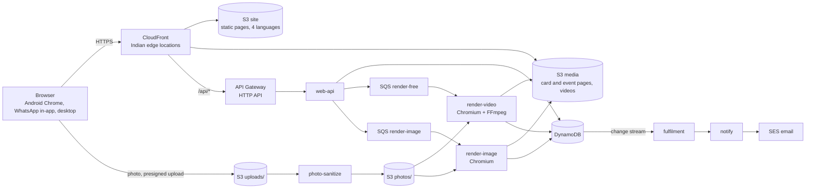
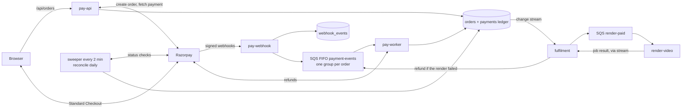
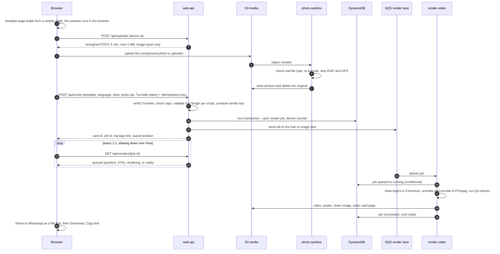
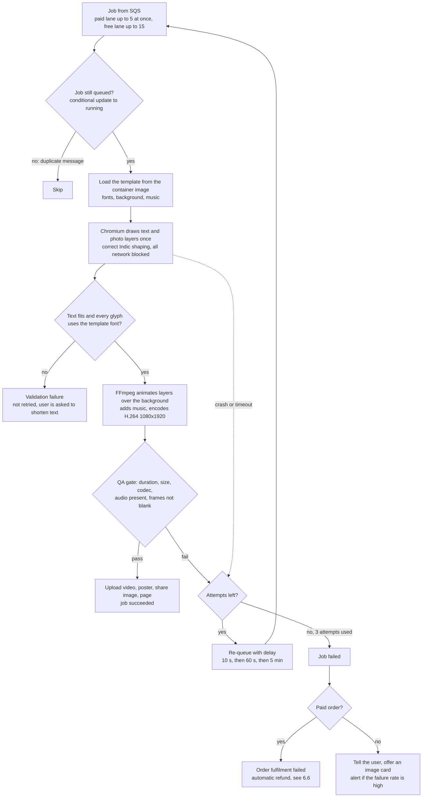
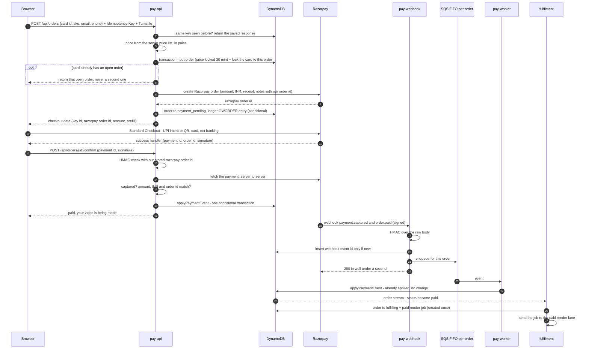
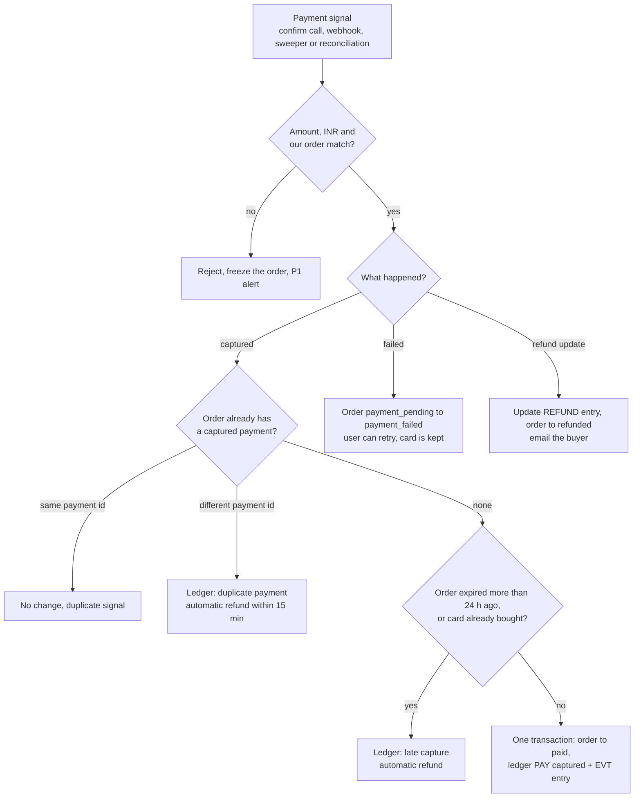
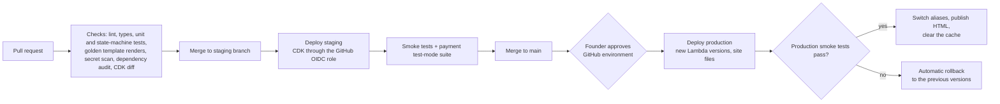

# 17 — High-Level Design (HLD): CardReel on the lean AWS stack

**Status:** v1 for founder review · **As of:** 26 October 2026 · **Owner:** Claude (engineering) + Founder (decisions)
**Scope:** what we build for **Phase 0** (free launch, Day 11) and **Phase 1** (payments, Day 18): architecture, data, flows, payments, scalability, security, quality, operations.
**Builds on:** `16` (stack decision) · `05` (payment rules and state machines) · `06` (alerts) · `07` (security) · `09` (launch scope) · `15` (release plan) · `11` (analytics).
**Not in scope:** V1+ features (accounts and OTP, Pass and subscriptions, second gateway, admin CMS). `04` remains the scale-up target for those.

Labels: **[V]** sourced · **[E]** estimate · **[A]** assumption to validate.

---

## In one minute

1. **Static first.** The website and every personal card and event page are plain files served by CloudFront from Indian edge locations. They open fast inside WhatsApp, cost almost nothing, and **keep working even if the backend is down**.
2. **Serverless backend.** Small Lambda functions behind API Gateway, with DynamoDB as the database. There are no servers to patch and no idle cost, and the backend scales on festival days without manual work.
3. **One template, two renderers.** The same HTML/CSS template runs as the instant preview in the browser and in headless Chromium for the final video. **What users preview is what they get**, with correct Hindi, Marathi and Tamil lettering.
4. **Fast videos.** Chromium draws each text and photo layer once. FFmpeg then animates those layers over a ready-made background. Target: **p95 ≤ 60 seconds** per video, and paid orders get their own lane, so they never wait behind free renders.
5. **Payments can't double-charge or lose money.**
   - The server sets the price.
   - The **webhook plus a server-side check with Razorpay** decide whether an order is paid. What the browser reports is never enough.
   - Every state change is a **single all-or-nothing database write** that only succeeds from the expected previous state.
   - Duplicates are detected and **refunded automatically**.
   - A sweeper and a daily reconciliation catch anything missed.
6. **Abuse can't run up the bill.** A bot check, per-device and daily caps, a 20-at-once render limit, budget alarms and kill switches give the bill a hard ceiling.
7. **Safe by default.**
   - Card links can't be guessed.
   - Managing a card needs a secret link token.
   - Secrets live only in AWS.
   - Uploaded photos are re-encoded and stripped of GPS data.
   - Logs are kept for **180 days in India**, as CERT-In requires.
8. **Cost: ≈ ₹100–600/month at launch** (`16` §4). The design runs at 10× festival traffic with **settings changes only**, no code changes.

---

## 1. Goals and design principles

| # | Principle | What it means in practice |
|---|---|---|
| P1 | **Static first** | Anything that doesn't change per request is a file on S3 behind CloudFront: the site, template previews, card pages, event pages, videos. The API handles only writes and a few reads. |
| P2 | **Pay per use, never idle** | Lambda, DynamoDB on-demand, SQS, SES. No NAT gateway, EC2, RDS or public IPv4 (`16` §2). |
| P3 | **Never trust the browser** | Prices, entitlements, payment status and limits are decided on the server. The browser only sends intent. |
| P4 | **Every write can be safely repeated** | Idempotency keys, conditional writes, de-duplicated events. A retry, double tap or duplicate webhook has no extra effect. |
| P5 | **Money never gets stuck** | Every captured payment ends **fulfilled or refunded**, checked by a sweeper (every 2 min) and daily reconciliation (`05` principle 3). |
| P6 | **The bill has a ceiling** | Caps, throttles, reserved concurrency and budget alarms, plus switches to turn off expensive features without a deploy. |
| P7 | **One template, two renderers** | Browser preview and server render use the same template package, so the preview matches the final output. |
| P8 | **Boring, observable, reversible** | Managed services, infrastructure as code, one-click rollback, an alert email for anything that touches money. |
| P9 | **Contained lock-in** | All data access goes through one repository layer. Moving to PostgreSQL or containers later (`04`) is a contained job. |

---

## 2. Requirements that shape the design

### 2.1 Capacity model **[E]**

| Scenario | Visitors / day | Cards created / day | Recipient opens / day | Peak API requests / s |
|---|---|---|---|---|
| Normal day after launch | 1–3k | 300–1,000 | 3–10k | < 5 |
| Festival day (Bhai Dooj, Diwali tail, wedding muhurat) | 10–30k | 3–8k | 50–150k | 20–40 |
| Viral day (a card spreads through WhatsApp groups) | ~100k | ~15k (caps apply) | 0.5–1M | ~150 |
| **Design ceiling (settings changes only)** | **1M** | ~50k renders | 5M+ | **1,000+** |

**How we got these numbers:**
- **Peak API rate** = visitors × 8 API calls × 20% in the peak hour ÷ 3,600 s × 3 for bursts. For 100k visitors that is ≈ 133 requests per second.
- **Recipient opens** mostly hit CloudFront, not the API.
- **Sharing sends the video file first**, so most recipients watch it inside WhatsApp and never download it from us. Card pages show a poster image first and load a lighter 720p web copy only when someone taps play. That keeps **1M opens within about 1 TB of CloudFront traffic** (free tier), not 4+ TB (≈ ₹9/GB beyond the free tier).

### 2.2 Non-functional targets (launch)

| Area | Target | Notes |
|---|---|---|
| Card / event page load (LCP, p75, 4G, mid-range Android) | **≤ 1.5 s** | ~30 KB HTML from an Indian edge; poster image first |
| Home / template pages (LCP, p75) | **≤ 2.5 s** | Static pages; ≤ 150 KB JavaScript (compressed); one font per script |
| API latency (p95, warm) | **≤ 300 ms**; order creation ≤ 1.5 s | Order creation includes a call to Razorpay |
| Image card render (p95) | **≤ 8 s** | Separate image lane |
| Video render (p95, tap → ready) | **≤ 60 s** normal; free lane ≤ 3 min at festival peak | Queue shows position and ETA |
| Paid video (payment → ready) | **≤ 90 s p95, at any load** | Paid lane with its own capacity |
| Availability (monthly) | Card/event pages **99.9%**; create, render, pay **99.9%** **[A]** | All parts span 3 data centres (availability zones) in Mumbai |
| Payment correctness | **0 lost payments.** Duplicates refunded ≤ 15 min. Automatic refund started ≤ 30 min (≤ 2 h if the refund safety brake holds it, §6.6) | Checked daily by reconciliation |
| Durability and recovery | S3 11 nines; DynamoDB point-in-time recovery for 35 days; **data loss window (RPO) ≤ 5 min; time to restore (RTO) ≤ 4 h** | §10.2 |
| Cost | **≤ ₹600/month at launch**; ≈ ₹0.23 per video beyond the free tier | §14 |
| Security and compliance | No card data on our systems (PCI SAQ A); secrets only in SSM; logs kept 180 days in India; payment data in India | §8 |

---

## 3. Architecture

### 3.1 System context



### 3.2 Components (AWS Mumbai, `ap-south-1`)

Everything runs in AWS Mumbai. Cloudflare provides only DNS and the Turnstile bot check. Every function reads its secrets and feature switches from **SSM Parameter Store** and writes logs and metrics to **CloudWatch** (not drawn, to keep the diagrams readable).

**Free path (Phase 0): browse, create, render, share**



**Payments path (Phase 1)**: all browser and webhook traffic also passes through CloudFront and API Gateway.



**Why a single CloudFront distribution for everything, including `/api/*`?**
- **Same origin:** the browser skips the extra "preflight" request that cross-site API calls need. That saves a full round trip on every write, which matters on Indian mobile networks.
- **One secure connection** per visitor, opened at a nearby edge.
- **Free DDoS protection** (AWS Shield Standard) in front of everything.
- **No direct access to the API:** API Gateway's default URL is switched off. CloudFront adds a secret header that the API checks, so requests that skip CloudFront get a 403. The secret is rotated from SSM.

### 3.3 CloudFront routes

| Path | Origin | Edge cache | Notes |
|---|---|---|---|
| `/_next/static/*`, `/fonts/*`, `/tpl/*` (template previews) | S3 site | 1 year, immutable | File names include a content hash |
| `/` | CloudFront Function | — | Redirects to `/hi/`, `/en/`, `/mr/` or `/ta/` (saved choice, else browser language) |
| `/{lang}/*` HTML | S3 site | 5 min | Indexed by search engines (SEO pages) |
| `/c/{card_id}` | S3 media `pages/c/` | 1 h; cleared on edit or takedown | **`noindex`**: personal pages are never listed on Google |
| `/e/{event_id}` | S3 media `pages/e/` | 1 h; cleared on edit | `noindex`; RSVP form posts to the API |
| `/r/*` (videos, images, PDFs) | S3 media `r/` | 30 days; new edits get new file names | Unguessable paths |
| `/api/*` | API Gateway | Not cached | Origin secret header; per-route throttles |
| Staging only: everything | — | — | CloudFront Function basic auth + `noindex` (`15` §2) |

### 3.4 Lambda functions

All run in Mumbai, **outside a VPC**: no NAT cost and faster cold starts. Each function has its own IAM role with only the access listed.

| Function | Trigger | Runtime / memory / timeout | Concurrency | Can access (least privilege) | Phase |
|---|---|---|---|---|---|
| `web-api` | `/api/*` except payments | Node.js 22, arm64, 1 GB, 10 s | Shared pool | `cards`, `events`, `rsvps`, `waitlist`, `reports`, `render_jobs`, `counters`, `idempotency_keys`; presign to `uploads/`; send to render queues; Turnstile secret | 0 |
| `photo-sanitize` | S3 upload event | Node.js 22 + sharp, 1 GB, 30 s | Reserved 10 | Read and delete `uploads/`; write `photos/` | 0 |
| `render-video` | SQS `render-paid` (max 5 at once) + `render-free` (max 15 at once) | Container, x86_64, **6 GB** (~3.5 vCPU), 3 min, 4 GB scratch disk | **Reserved 20** (the cap from `16`) | Read `photos/`; write `r/` and `pages/`; update `render_jobs`, `cards`. **No secrets, no payment tables** | 0 |
| `render-image` | SQS `render-image` | Container, 2 GB, 30 s | Reserved 10 | Same as `render-video` | 0 |
| `fulfilment` | DynamoDB streams on `render_jobs` (and `orders` in Phase 1) | Node.js 22, 512 MB, 30 s | Per stream shard | `cards`, `render_jobs`, `orders`; send to `render-paid`, `payment-events`, `notify` | 0 / 1 |
| `notify` | SQS `notify` | Node.js 22, 256 MB, 15 s | Max 5 | SES send; read contact fields | 0 |
| `pay-api` | `/api/orders*` | Node.js 22, arm64, 1 GB, 15 s | **Reserved 20** | `orders`, `payments`, `cards` (order lock fields), `idempotency_keys`; Razorpay key secret | 1 |
| `pay-webhook` | `/api/webhooks/razorpay` | Node.js 22, arm64, 512 MB, 4 s | **Reserved 10** | `webhook_events` (insert only); send to `payment-events`; **webhook secret only** | 1 |
| `pay-worker` | SQS FIFO `payment-events` | Node.js 22, arm64, 512 MB, 30 s | Max 5 | `orders`, `payments`, `webhook_events`; Razorpay key secret | 1 |
| `sweeper` | Scheduler, every 2 min | Node.js 22, 512 MB, 60 s | 1 | `orders`, `payments`, `render_jobs`; Razorpay read calls | 0 / 1 |
| `reconcile` | Scheduler, daily 06:00 IST | Node.js 22, 1 GB, 5 min | 1 | Read payment tables; Razorpay read calls; write `ops/recon/`; SES | 1 |
| `health-check` | Scheduler, every 5 min | Node.js 22, 256 MB, 20 s | 1 | Calls public URLs; publishes metrics | 0 |
| `log-archive` | Scheduler, daily | Node.js 22, 256 MB | 1 | CloudWatch Logs export to `ops/logs/` | 0 |
| `keep-warm` | Scheduler, every 5 min, 07:00–23:00 IST | — | — | Pings `render-video` so the first video of the morning isn't slow | 0 |

**Bulkheads.** Payments, webhooks and paid renders have **reserved capacity**. A flood of free traffic (a bot, or a viral day) can't starve checkout, webhooks or paid videos. Reserved total = 70 (20 + 10 + 20 + 10 + 10), and AWS keeps at least 100 unreserved, so the **account quota must be ≥ 170**. New accounts start with lower quotas **[V]**, so request **1,000 on Day 1** (`16` §5.3).

**Architecture:** API functions use **arm64 (Graviton)**, which is about 20% cheaper per second of compute. Render containers use **x86_64** at launch, because Chromium and FFmpeg builds are best tested there. We'll try arm64 for rendering once the golden tests (§9.2) pass on it.

### 3.5 API surface

| Method and path | Purpose | Authorisation | Protection |
|---|---|---|---|
| `POST /api/uploads` | Get a presigned photo upload | Device ID (limits only) | 20 per device per hour |
| `POST /api/cards` | Create a card and start its render, in one call | — | Turnstile, Idempotency-Key, daily caps |
| `GET /api/renders/{job_id}` | Render progress, queue position, ETA | Job ID (unguessable) | Throttled |
| `PATCH /api/cards/{id}` · `DELETE /api/cards/{id}` | Edit (re-render) or delete a card and its files | **Manage token** | Limits |
| `POST /api/cards/{id}/manage-link` | Email the manage link again | Email on file | 3 per day |
| `POST /api/events/{id}/rsvps` | Guest RSVP | — | Turnstile, per-device and per-event limits |
| `GET /api/events/{id}/rsvps` · `PATCH /api/events/{id}` | Host sees RSVPs, edits the event | **Host token** | — |
| `POST /api/waitlist` | "Notify me" with consent | — | Turnstile |
| `POST /api/reports` | Report a card or event page | — | Turnstile |
| `POST /api/orders` | Create a paid order | — | Turnstile, Idempotency-Key, 10 per device per hour |
| `POST /api/orders/{id}/confirm` | Checkout success **hint** | Order token | — |
| `GET /api/orders/{id}` | Order and payment status | Order token | Throttled |
| `POST /api/webhooks/razorpay` | Gateway events | **HMAC signature** | Body ≤ 256 KB; separate route throttle |
| `GET /api/health` | Synthetic checks | — | — |

Errors come back as `{code, message_key, retry_after}`. The browser shows the message in the user's language.

---

## 4. Data design

### 4.1 DynamoDB tables

There are a few clear tables, not one complex single-table design (`16` §3). Tables, streams and indexes are defined in CDK.

| Table | Key (partition / sort) | Secondary indexes | Expiry (TTL) | Holds | Phase |
|---|---|---|---|---|---|
| `cards` | `card_id` | `by_owner_email` (keyed hash of the email → cards, for "resend my links") | Unrendered drafts: 7 days | Template + version, language, slot values, photo IDs, status, tier, current render, **manage-token hash**, event ID | 0 |
| `events` | `event_id` | — | 90 days after the last function → archived | Inviting family, functions, venues, header symbol, RSVP settings, **host-token hash** | 0 |
| `rsvps` | `event_id` / `rsvp_id` (time-sorted) | — | 12 months | Guest name, head count, functions attending, optional phone, message | 0 |
| `waitlist` | `contact_hash` / `interest` | — | On withdrawal, or after 12 months | Contact, consent text version, time, language, source | 0 |
| `render_jobs` | `job_id` | `by_render_key` (reuse a finished render) | 90 days | Card, lane, attempt, status, timings, error code | 0 |
| `counters` | `counter_key` | — | End of window | Rate limits, daily caps (spread over 10 keys, §7.3), alert de-duplication, refund-brake counter | 0 |
| `idempotency_keys` | `scope + key` | — | 24 h | Request hash, status (in progress / done), saved response | 0 |
| `reports` | `report_id` | `by_status` | 1 year | What was reported, reason, action, timestamps (IT Rules records) | 0 |
| `orders` | `order_id` | `by_card`; sparse `sweep` (shard, `sweep_due_at`) | None. **Kept 8 years** for tax records **[A: confirm with CA]** | Card, SKU, **amount in paise**, price version, status, **version number**, captured payment ID, buyer email and phone, current gateway order | 1 |
| `payments` (order ledger) | `order_id` / `GWORDER…`, `PAY…`, `REFUND…`, `EVT…` | `by_gateway_id` (any Razorpay order, payment or refund ID → our order) | None | Every Razorpay order attempt, payment, refund, and an **append-only event log** of each state change | 1 |
| `webhook_events` | `event_id` (from `x-razorpay-event-id`) | — | 90 days | Event type, received time, raw body, processing status | 1 |

**Changes from the table list in `16` §3:**
- `refunds` is folded into the `payments` ledger. One query then shows everything that happened to an order, which helps support, reconciliation and disputes.
- `idempotency_keys` and `reports` are added.

### 4.2 Consistency rules

- **Conditional writes for every status change.** A write such as "set status = paid only if the status is currently payment_pending or expired" either applies once or fails harmlessly. A failed condition means someone else already applied it, so we re-read and return the current state.
- **Transactions** (`TransactWriteItems`, all-or-nothing, up to 100 items across tables) whenever two things must change together. Examples: the order status, the ledger entry and the event log; or a card, its render job and the device counter.
- **Change streams as the outbox.** Fulfilment (start the paid render, send the receipt, start a refund) is triggered by DynamoDB Streams when a status changes, not by the code that changed it. Whichever path marks an order paid (browser confirm, webhook, sweeper or reconciliation), fulfilment starts **exactly once in effect**: the stream may deliver twice, but the render job write only succeeds once.
- **Optimistic locking** on orders: a `version` number is checked and incremented on every update.
- **Money:** integers in paise, currency `INR` only, and the price version is stored on the order.
- **Time:** stored in UTC (ISO 8601). Muhurat and function times are stored as local time with `Asia/Kolkata`.
- **IDs:**
  - Public card and event IDs: 16 random characters (~95 bits), so they **can't be guessed or listed**.
  - Internal IDs: time-sortable (ULID).
  - Tokens: 128-bit random; only their SHA-256 hash is stored.

### 4.3 S3 layout and lifecycle

| Bucket / prefix | Contents | Who can access | Lifecycle |
|---|---|---|---|
| `site` | Next.js build, search index, template previews | CloudFront only (origin access control) | Keep the last 10 builds for rollback |
| `media/uploads/` | Raw uploads | Write-only via presigned POST (5 min, ≤ 5 MB, JPEG/PNG/WebP/HEIC) | Deleted by the sanitizer straight away; 1-day safety net |
| `media/photos/` | Cleaned photos (re-encoded, no EXIF or GPS) | Render functions | **30 days** (`16` §1) |
| `media/r/` | Rendered videos, images, PDFs, posters, share images | CloudFront | By object tag: **`tier=free` 12 months, `tier=paid` 3 years** (`09` §2) |
| `media/pages/c/`, `media/pages/e/` | Static card and event pages | CloudFront | Same tags. Event pages: 90 days after the last function. Then an "expired" page with **Make your own** |
| `media/takedown/` | Content removed after a report | Private | **Kept 180 days**: the IT Rules require removed content to be preserved for investigations |
| `ops/` | Database exports, reconciliation reports, **log archive** | Founder (read), functions (write) | Logs 180 days; exports 35 days; reconciliation 8 years |

Versioning is on for the media bucket, with old versions deleted after 7 days. That protects against an accidental overwrite or delete for a few rupees a month.

---

## 5. Key flows

### 5.1 Create → render → share



**Details that protect quality and cost:**
- **Photos upload in the background** as soon as they're picked, so pressing "Create" doesn't wait for an upload.
- **Render key** = hash of the template version, slot values, photo hashes, format and tier. Pressing "Create" twice, or a network retry, **reuses the same job or finished file**. No second render, no second charge to our bill.
- **No login.** The response includes a **manage link** (`/m/{card_id}#token`). The token sits after the `#`, so browsers never send it to servers or log files. It is saved on the device under "My cards on this device", and emailed if the user gives an address. It lets the owner edit, re-download or delete the card.
- **Card page:** a static HTML file with correct share-preview tags. The share image is 1200 × 630, kept under 300 KB so WhatsApp shows a preview **[V]**. The page also carries the **Make your own** button, the "Safe link: no app, no login" line and a Report link. Pages are `noindex`.

### 5.2 Recipient, event page and RSVP

1. The recipient opens `/e/{event_id}` from WhatsApp. It's a static page served from the edge, which shows the functions, map link and add-to-calendar file.
2. The RSVP form posts to `POST /api/events/{id}/rsvps`, protected by Turnstile and per-device/per-event limits. The host sees replies on their manage page using the host token.
3. When the host edits a time or venue, the page is rebuilt and the cached copy cleared (CloudFront allows 1,000 free clearing paths a month).
4. **If the API is down,** the event page still opens. Only the RSVP button shows "try again in a few minutes".

### 5.3 Render pipeline



**Why layers and not frame-by-frame capture?** The earlier plan (`09` §4) had Chromium capture every frame (600 frames for a 20-second video). That is slow on Lambda.
- Instead, Chromium draws each **text or photo layer once**, as a transparent image, using its proper Indic text shaping.
- FFmpeg then handles the motion (fade, slide, zoom) by **compositing those layers over a pre-rendered background loop**.
- This is several times faster **[E]**.
- A few special templates that truly need frame capture get a longer time budget and are marked in the catalogue.

**Retries:** the worker catches errors and re-queues the job with a delay (10 s, 60 s, 5 min), as in `05` §3.1. If it crashes or times out instead, SQS delivers the job again after the visibility timeout. After 4 deliveries the job goes to a **dead-letter queue (DLQ)**, which raises an alarm and is treated as a failure (refund if paid).

**Renderer safety:**
- No user-supplied URL is ever fetched.
- Chromium blocks every network request except the local template files.
- User text is inserted as text, never as HTML.

### 5.4 "Notify me" (Phase 0)
1. `POST /api/waitlist` with contact details, interest, the consent text version and Turnstile. The write is idempotent per contact and interest.
2. A confirmation email is sent through SES with a one-click withdraw link.
3. The analytics events `ui_click(premium_notify_me)` and `form_submit(premium_waitlist)` fire as in `11` §4.9.

---

## 6. Payments (Phase 1)

The rules in `05` stay the source of truth. This section is how they're built on Lambda + DynamoDB, with special attention to **many and concurrent payment requests**.

### 6.1 Payment security controls

| Threat | Control |
|---|---|
| Browser changes the price | Price comes from a **server-side price list** (SKU → paise, versioned). The browser only sends the card ID and SKU. The Razorpay order amount = our stored order amount. |
| Fake "payment success" from the browser | The browser callback is only a **hint**. We check the signature `HMAC_SHA256(our stored razorpay_order_id + "|" + payment_id, key_secret)`, then **fetch the payment from Razorpay server-to-server** and check it is captured and that the amount, currency and order ID match. |
| Replaying a valid callback from another order | The signature is checked against **our stored Razorpay order ID for this order**, never one supplied by the browser. |
| Forged webhooks | HMAC-SHA256 over the **exact raw request body** with the webhook secret, compared in constant time. API Gateway may base64-encode the body, so we decode it and never re-serialise the JSON. Invalid → 400 + security alarm. |
| Leaked keys | Key secret and webhook secret live in **SSM Parameter Store (SecureString)**, per environment. Only the `pay-*` functions' roles can read them. Test and live keys are separate. The rotation runbook supports two webhook secrets during a switch. |
| Card data exposure | **Razorpay Standard Checkout** (hosted), so card and UPI details never reach our servers. Target **PCI SAQ A**. |
| Script tampering on the payment page | Only our own bundled scripts, Razorpay's and Turnstile's load where checkout opens. No tag managers or ad pixels. A strict **Content Security Policy** allowlists Razorpay's documented hosts. Checkout analytics are also sent from the server. |
| Leaking payment data | No payment data or contact details go to PostHog or Sentry. Logs mask phone and email. Payment records stay in **AWS Mumbai**. |
| Account takeover of the Razorpay dashboard | Two-step login, founder-only access, alerts on settings changes. |

### 6.2 Checkout sequence



**The webhook does almost nothing in the request.** It verifies, de-duplicates, queues and answers. Razorpay expects a 2xx **within 5 seconds**, retries with back-off for **24 hours**, and **disables a webhook that keeps failing** **[V]**. A fast, simple endpoint keeps us well clear of that.

**Why an SQS FIFO queue with one group per order?** Events for the **same order are processed one at a time, in arrival order**. Different orders are still processed in parallel, so thousands of buyers don't queue behind each other. The conditional writes make it correct even without FIFO; FIFO just removes needless conflicts.

### 6.3 One code path for every payment signal

The browser confirm call, the webhook worker, the sweeper and the daily reconciliation **all call the same function**, `applyPaymentEvent`. There is one set of rules, tested once.



Every arrow is a **conditional write**. If two signals race, exactly one wins and the other becomes "no change". **Out-of-order events** are logged as ignored and never move an order backwards. Example: `payment.failed` arriving after `payment.captured`.

### 6.4 Multiple and concurrent payment requests

| # | Situation | Risk | How the design handles it |
|---|---|---|---|
| C-1 | **Double tap on "Pay"**, or a network retry | Two orders, two charges | The browser makes one **Idempotency-Key per checkout screen**. Same key + same body → the saved response; same key + different body → 409. |
| C-2 | **Two tabs or two family members** pay for the same card | Two charges | Each card can have **only one open order** (a lock on the card, set in the same transaction). Both tabs get the same order. Razorpay **blocks a second payment once an order is paid, or while a payment is authorised** **[V]**. If two captures still slip through, C-3 refunds the extra. |
| C-3 | Two captures for one order (rare UPI race) | Customer charged twice | `applyPaymentEvent` keeps the first and records the other as a duplicate. **Automatic refund within 15 min**, with an email. |
| C-4 | **Browser confirm and webhook arrive together** | Double fulfilment, two emails | Both run the same conditional transaction; one wins. Fulfilment starts from the change stream, and the render job is created only once. |
| C-5 | **Same webhook delivered several times** (Razorpay delivers at least once **[V]**) | Repeated processing | `webhook_events` insert only if `event_id` is new; duplicates get 200 straight away. |
| C-6 | **Webhooks out of order** | Wrong final state | Each change is allowed only from listed previous states (`05` §2.4). Others are logged as ignored. |
| C-7 | **User closes the browser** right after paying | Paid, nothing delivered | The webhook (or the sweeper) marks it paid; the render runs; the **receipt and manage link go by email** (email is required at checkout). |
| C-8 | **UPI approval takes minutes** | User pays again | The order page shows "Checking your payment…". The Pay button stays off while a payment is pending. The status call checks Razorpay on demand (at most once per 15 s per order), and the sweeper checks every 2 min. |
| C-9 | **Retry after a failed payment** | Razorpay rejects reuse of the old order | Each new checkout after a failure gets a **fresh Razorpay order** for the same CardReel order, as Razorpay requires **[V]**. The old one is marked superseded in the ledger. A late payment on it is still mapped back to us (`by_gateway_id`) and handled by C-3 or C-10. |
| C-10 | **Payment captured after the order expired** (30 min) | Money taken, nothing delivered | Within 24 h: **fulfil** and email. After 24 h, or if the card was already bought: **automatic refund** (`05` §2.6). |
| C-11 | **Razorpay create-order call times out** | A Razorpay order may exist that we don't know about | We retry once (3 s timeout). An unknown Razorpay order is never shown to the user, so it stays unpaid. Our order ID is in its `notes`, so any payment on it still maps back. |
| C-12 | **A worker crashes halfway** | Half-applied state | Each change is one all-or-nothing transaction. SQS delivers the event again, and re-running it is harmless. After 5 attempts → dead-letter queue + P1 alert. |
| C-13 | **Refund call times out** | Double refund | Before calling, a `REFUND` ledger entry with a fixed key (`{order}:{reason}:{n}`) is written. The call sends Razorpay's **`X-Refund-Idempotency`** header with that key, so a retry can't refund twice **[V]**. |
| C-14 | **Price changes while someone is paying** | Charged a different amount | The price is locked on the order for 30 min (`price_version`). |
| C-15 | **Bot floods order creation** | Razorpay API limits, noise | Turnstile, 10 orders per device per hour, one open order per card, a separate route throttle. |
| C-16 | **Many buyers at once** (festival rush) | Slow checkout | `pay-api` has **reserved capacity** (20 at once ≈ 15–20 orders per second, at ~1 s each including Razorpay). FIFO groups run in parallel per order. Payments never compete with free renders. |

### 6.5 Order states

The order, payment and refund state machines are those in **`05` §2.4**. Two lean-stack details:
- Every transition is a DynamoDB conditional update on `status` (and `version`), plus an `EVT` ledger entry, in **one transaction**.
- `payment_failed → payment_pending` creates a **new Razorpay order** (C-9). Our order ID never changes.

### 6.6 Refunds

- **Automatic triggers** (`05` §3.1):
  - render failed after 3 attempts;
  - duplicate payment;
  - late capture after 24 h;
  - card no longer deliverable.
- **Flow:**
  1. `fulfilment` marks the order `fulfillment_failed` and queues a refund event (FIFO, same order group).
  2. `pay-worker` writes the `REFUND` ledger entry.
  3. It calls Razorpay's refund API with **`speed: optimum`** (instant where possible, otherwise normal **[V]**), the idempotency header and notes `{order_id, reason}`.
  4. The order moves to `refund_pending`, then `refunded` on the `refund.processed` webhook.
  5. The buyer gets an email in their language: "₹399 refunded. It reaches your account in 1–5 working days (or instantly)."
- **Refund safety brake (new).** If **more than 5 automatic refunds happen within 30 minutes**, new automatic refunds are **held for up to 2 hours** and you get a P1 alert with a one-click **Release refunds** link. A sudden burst usually means a bad deploy or a template bug that a quick fix would solve; refunding everyone first would lose the sale and the customer's trust. Held refunds release automatically after 2 hours, so nobody waits longer than that.
- **Manual refunds** (support): an ops script shows the order and asks for a typed confirmation and a reason. Every Phase 1 price is ≤ ₹399, so the ">₹500 needs a second approver" rule in `05` doesn't apply yet. It comes back with a team or higher prices.
- `refund.failed` → retry 3 times (5 min, 30 min, 2 h) → P1 alert (`05` §3.2).

### 6.7 Sweeper and reconciliation

**Sweeper** (EventBridge Scheduler, every 2 minutes). Each open order carries a `sweep_due_at` time in a **sparse index**, so only orders that need attention are read:

| Order state | Sweeper check |
|---|---|
| `created` | Expire after 30 min |
| `payment_pending` | From 3 min, ask Razorpay for the order's payments and apply them. Expire at 30 min, then check again at 1 h and 24 h for late captures |
| `paid` / `fulfilling` | Older than 15 min → re-queue the paid render + P1 alert (`06` A6) |
| `refund_pending` | Older than 24 h → fetch the refund status + P2 alert |
| Finished orders | Removed from the index |

**Daily reconciliation, 06:00 IST:** a three-way check for the previous day (`05` §4.2).
1. Razorpay payments and refunds for the previous day are matched with ours by Razorpay ID.
2. **Captured at Razorpay but not paid here** → fixed automatically through `applyPaymentEvent`.
3. **Paid here but not captured at Razorpay**, or an amount mismatch → P1 alert, and that order is frozen.
4. **Settlements** are checked against captured − fees − refunds.

You get a daily email with the totals and any mismatches; the CSV is saved in `ops/recon/`.

### 6.8 Payments: user-experience risks specific to India

- **UPI inside WhatsApp's in-app browser.** Opening a UPI app from an in-app browser can fail on some phones.
  - The checkout page detects in-app browsers and offers **"Open in Chrome to pay with your UPI app"**.
  - Razorpay's **QR and UPI ID** options remain as a fallback.
  - This is in the device test matrix (`15` §5).
- **Pending UPI.** Clear "Checking your payment…" copy; never a second Pay button while a payment is pending (C-8).
- **Refund timing.** Messages give honest timelines (instant or 1–5 working days) with the Razorpay refund reference.

---

## 7. Scalability

### 7.1 How each part scales

| Part | How it scales | Limit to know | Our setting / action |
|---|---|---|---|
| CloudFront | Global edge network | Very high | Absorbs viral recipient traffic; Indian edge locations |
| API Gateway (HTTP API) | Managed | **10,000 requests/s per account per region** by default **[V]** | Stage throttle 200/s steady, 400 burst; separate route limits for orders and webhooks. Raise in config. |
| Lambda | One instance per concurrent request | **1,000 concurrent by default; new accounts start lower** **[V]** | Request 1,000 on Day 1; reserved capacity for payments and renders (§3.4) |
| DynamoDB on-demand | Automatic | **1,000 writes / 3,000 reads per second per partition** **[V]** | Spread keys (§7.3); pre-warm before festivals (§7.2) |
| SQS | Practically unlimited | FIFO: high-throughput mode if needed | Far below limits |
| Render | Lambda reading SQS, capped by **maximum concurrency per queue** **[V]** | 20 at once ≈ **40 videos/min ≈ 2,400/hour** | Raise to 50–100 in config when the budget allows (~₹0.23 per video) |
| S3 | Per key prefix | 3,500 writes / 5,500 reads per second per prefix | Keys start with random IDs |
| SES | Sending quota | Set when production access is granted | Ask for ~50k/day |
| Razorpay | External | Unpublished per-merchant limits | 3 s timeouts, one retry, order-create limits |

### 7.2 Festival readiness (every major festival or muhurat cluster)

| When | Action |
|---|---|
| T-7 days | Load test staging at **3× the expected peak** (§13). Check Lambda quota and SES quota. Pre-render template backgrounds. Decide the render cap and the daily free cap with the budget in mind. |
| T-3 days | Set **DynamoDB warm throughput** on `cards`, `render_jobs` and `counters`. This one-time pre-warm has a small charge and can't be lowered later **[V]**. |
| T-2 to T+1 | **Deploy freeze** (fixes only). Alerts go to two inboxes. |
| T-0 | Watch the dashboard. If the free queue grows, degrade gracefully, in this order: (1) longer queue with ETA and "email me when ready"; (2) daily free videos 5 → 3; (3) free users offered image cards only. **The paid lane is never degraded.** |

### 7.3 Hot spots and how we avoid them

- **Global counters** (daily free-render budget) are spread across 10 keys. Writes pick one at random, and reads add them up. This avoids a single overloaded key.
- **A viral event page** (a big wedding with many RSVPs) writes to one partition. That's still far below 1,000 writes/s.
- **The sweeper index** uses a few shard values and holds only open orders, so it stays small.
- **Template catalogue reads** never touch the database: they come from static JSON at the edge.

### 7.4 When to evolve (triggers, not dates)

| Signal | Next step |
|---|---|
| > 50k videos/month, or render cost > ₹5k/month | Move video encoding to **ECS Fargate Spot / AWS Batch** workers reading the same queue with the same container (≈ 5× cheaper per video at volume **[E]**) |
| Weekly need for ad-hoc SQL or finance reports | Stream DynamoDB to Athena views; later PostgreSQL per `04` §6 via the repository layer |
| Repeat buyers want accounts | WhatsApp OTP login (V1) |
| Payments > ~₹5 lakh/month, or a Razorpay outage hurts | Second gateway (Cashfree) behind the gateway interface (`05` §1) |
| Attack traffic | **AWS WAF** on CloudFront with rate-based and bot rules (~₹700+/month), switched on from a runbook |
| > 200k monthly users | Provisioned concurrency for API cold starts, tracing (X-Ray), cross-region backup copies |

---

## 8. Security

### 8.1 Main threats and controls

| Threat | Controls |
|---|---|
| **"Denial of wallet":** bots trigger renders or emails to run up the bill | Turnstile on every costly action; per-device and per-IP caps; global daily caps; reserved concurrency (max 20 renders); AWS Budgets alerts at ₹500/₹2,000 and anomaly detection; kill switches (§10.3) |
| Payment fraud and tampering | §6.1 |
| **Guessing other people's cards or RSVPs** | Random 95-bit IDs; no list or search API for user content; manage and host tokens stored only as hashes; RSVP lists need the host token; personal pages are `noindex` |
| **Script injection (XSS) through names or messages** | The static page generator escapes all text; templates insert text, never HTML; strict Content Security Policy with no inline scripts; links in user content allowed only to Google Maps and YouTube |
| **Malicious photo uploads** | Presigned POST with size and type conditions; real-type check; full re-encode (defeats disguised files); EXIF/GPS stripped; 25-megapixel limit; raw file deleted immediately |
| **Renderer abuse** (fetching internal URLs) | No URL inputs; Chromium network blocked except local template files; the render role has no secrets |
| **Phishing using our domain** (the APK wedding-invite scam) | Allowlisted links only; no file types besides our own outputs; "no app, no login" wording; Report button; takedown within 3 hours (§8.5) |
| **Leaked secrets** | SSM Parameter Store; GitHub Actions uses **OIDC** (no stored AWS keys); GitHub secret scanning + push protection; `gitleaks` in CI; never in chat |
| **AWS account takeover** | Root MFA, root unused; IAM Identity Center with MFA; no IAM users with access keys; CloudTrail management events on (free). GuardDuty recommended after launch (~₹100–300/month **[E]**) |
| **DDoS** | CloudFront + **Shield Standard** (free, automatic); route throttles; static pages keep working during an API attack; WAF runbook |
| **Supply chain** | Lockfile, Dependabot, `npm audit` in CI; pinned Chromium, FFmpeg and fonts in the container; free ECR image scanning |
| **Data leaks through logs or analytics** | Phone and email masked in logs; no personal data to PostHog or Sentry (PII sending off, scrubbing on); tokens and signatures never logged |

### 8.2 Access without logins

| Credential | Lets you | How it's protected |
|---|---|---|
| **Manage token** (card owner) | Edit, re-download, delete the card | 128-bit random; only its hash stored; kept after `#` in the URL; can be re-sent to the email on file, which replaces the old token |
| **Host token** (event) | See RSVPs, edit the event | Same |
| **Order token** | See order and payment status | Returned when the order is created; kept on the device; also emailed |
| **Device ID** | **Nothing**: rate limits and analytics only | Random ID in browser storage; never used to authorise anything |
| **Ops access** | Everything | AWS SSO with MFA. Alert emails carry **signed one-click action links** (takedown, release refunds): single use, 24-hour expiry |

### 8.3 Layered limits (launch defaults; all adjustable without a deploy)

| Action | Limit |
|---|---|
| Free video renders | **5 per device per day** (`09` §0); 30 per IPv4 address; 10 per IPv6 /64 |
| Image renders | 30 per device per day |
| Photo uploads | 20 per device per hour |
| RSVP | 5 per device per event per day; 500 per event per day |
| "Notify me", reports | 3 per device per day |
| Manage-link emails | 3 per email per day |
| Orders (Phase 1) | 10 per device per hour; 1 open order per card |
| Global free video budget | e.g. 3,000 per day, then queue-only or image-only |
| API Gateway | 200 requests/s steady, 400 burst (stage); separate route limits for payments |

**Why IP limits are generous:** Indian mobile networks put many users behind one shared IPv4 address (carrier-grade NAT). Strict per-IP limits would block real people at festival peaks. The **device ID + Turnstile** pair is the main control. IP limits only catch obvious floods.

### 8.4 Platform hardening

- **Encryption:** TLS everywhere (HSTS on). DynamoDB, S3 and SQS are encrypted at rest by default.
  - Per-field encryption of buyer contact details with a dedicated KMS key (~₹85/month) is **deferred until accounts launch**.
  - Until then, contact fields are readable only by the functions that need them, and masked in logs.
- **Security headers** (CloudFront response headers policy):
  - Content Security Policy;
  - HSTS;
  - `X-Content-Type-Options: nosniff`;
  - `Referrer-Policy: strict-origin-when-cross-origin`;
  - `frame-ancestors 'none'`;
  - a `Permissions-Policy` that turns off camera, microphone and location.
- **Origin protection:** API Gateway's default URL is disabled, and the API checks the CloudFront secret header.
- **Separate environments:** staging and production in separate AWS accounts (recommended, `16` §5.3). Separate secrets, and production data is never copied to staging.

### 8.5 Privacy and Indian compliance

| Requirement | How the design meets it |
|---|---|
| **CERT-In directions (2022):** keep ICT logs for a **rolling 180 days within India**; report incidents within 6 hours **[V]** | CloudWatch keeps 14 days for searching. A **daily export to `ops/logs/` in Mumbai keeps 180 days**, then deletes. This corrects `16` §2, which had 14 days only. The incident runbook includes CERT-In reporting. |
| **DPDP Act and Rules:** notice and consent, minimal data, deletion, breach notice (Board: without delay, detailed report within 72 h **[V]**) | Notices in 4 languages; explicit consent for "Notify me"; only the data a card needs; TTL-based deletion (§4); delete from the manage link; breach runbook (`07` §7) |
| **IT Rules:** takedown of unlawful content within **3 hours** (`07` §5); keep removed content for investigations | Report → alert email with a signed **Take down** link; the page is replaced at once and the cache cleared; content moved to `takedown/` for **180 days** |
| **RBI payment data in India; PCI** | Payment records only in Mumbai; hosted checkout (SAQ A); no card data |
| **Consumer e-commerce rules** | Seller details, pricing, refund policy and grievance contact on the site (`09` §7) |

---

## 9. Quality: time and output

### 9.1 Speed (how we hit the targets in §2.2)

| Step | Target | Techniques |
|---|---|---|
| Home and template pages | LCP ≤ 2.5 s (p75, 4G) | Static HTML at the edge; HTTP/3 and Brotli; ≤ 150 KB JavaScript; **one subset font per script**, loaded only for the chosen language; template previews as posters first, short loops loaded lazily |
| Card / event page | LCP ≤ 1.5 s | ~30 KB HTML; poster image sized correctly; the video uses `preload="none"` and a 720p web copy with fast start |
| Live preview | Instant | The template runs in the browser; no server round trip |
| API | p95 ≤ 300 ms warm; ≤ 1 s cold | Small esbuild bundles; arm64; no VPC; DynamoDB in single-digit milliseconds; same-origin calls (no preflight) |
| Video render | p50 ≈ 30 s, p95 ≤ 60 s **[E]** | Layer-based rendering; 6 GB memory (~3.5 vCPU); backgrounds pre-rendered; paid lane; keep-warm pings |
| Pay → video | p95 ≤ 90 s | Paid lane with reserved capacity; fulfilment triggered by change streams |

**Measured, not assumed.** Render times are measured in the testing week (`15`). If p95 is over 60 s, the options in order are:
1. memory 6 → 10 GB (more CPU);
2. faster encoder preset;
3. a shorter free video.

### 9.2 Output quality

- **One template package** (`packages/templates`) drives both the browser preview and the server render. Only the watermark differs.
- **Text always fits.**
  - Each text slot shrinks between a minimum and maximum size.
  - If text still doesn't fit, the editor asks the user to shorten it **before** rendering.
  - We never output clipped text.
- **No missing-glyph boxes.** Fonts are bundled in the container, never downloaded at render time. A render fails validation if any character falls back to a font outside the template.
- **WhatsApp-ready video** (`09` §2):
  - ≤ 60 s, 9:16, 1080 × 1920, 30 fps;
  - H.264 High with yuv420p, AAC 128 kbps, fast start;
  - **≤ 8 MB for 30 s and ≤ 16 MB for 60 s**;
  - text inside the safe zones;
  - a "send as document for full HD" tip.
- **Automatic QA on every render:** `ffprobe` checks duration, resolution, codecs, audio and size; sampled frames are checked to make sure they aren't blank. A failed check counts as a failed attempt.
- **Golden tests in CI:** every template × 4 languages × short, long and mixed-script names is rendered and compared with approved reference images. **Native speakers approve the Marathi and Tamil references** (`09` §7).
- **Reproducible:** Chromium, FFmpeg and fonts are pinned in the container image. The same inputs give the same file, so the render cache is safe.
- **Audio:** licensed tracks only, normalised to a consistent loudness, with a licence record per track.

### 9.3 Graceful degradation

| Under pressure | What users get |
|---|---|
| Free render queue is long | Position and ETA, "email me when it's ready", option to make an image card now |
| Render service failing | Free: an apology and an image-card offer. Paid: retries, then the refund safety brake and refund (§6.6) |
| API down | Shared cards and event pages still open; the editor keeps the draft on the device and retries |
| Razorpay slow or down | "Payments are slow, please try again in a few minutes"; free features are unaffected; no partial orders |
| Email (SES) problem | The manage link is always shown on screen and saved on the device, never only emailed |

---

## 10. Reliability and failure handling

### 10.1 Failure modes

| What fails | What users see | Automatic response | Alert |
|---|---|---|---|
| Bad render deploy | "Taking longer than usual" | Retries; dead-letter queue; refund safety brake; one-click rollback | Render failure rate; DLQ not empty |
| Render backlog at peak | Queue position and ETA | Paid lane protected; caps | Queue age |
| API or DynamoDB problem | Editor can't save (draft kept); shared cards still open | Browser retries with back-off | 5xx rate; health check |
| Razorpay outage | Friendly retry message | Fast failure (3 s), no partial state | Gateway errors |
| Webhooks not arriving | A short delay before "paid" | On-demand status check, sweeper, daily reconciliation | No webhooks while payments are pending |
| SES suspended (bounces) | Manage link on screen | Suppression list; bounce handling | Bounce / complaint rate |
| Bad template | Error before rendering | **Per-template switch** (`disabled_templates`) | Per-template failure rate |
| Bot or cost attack | Stricter limits, occasional bot challenge | Caps and throttles; budget alarm | Budgets; anomaly; spike in 429 responses |
| Leaked secret | Nothing | Rotation runbook | GitHub secret-scanning alert |
| Accidental data deletion | — | Point-in-time restore (35 days); S3 versioning | — |

### 10.2 Backups and recovery

- **DynamoDB:** point-in-time recovery on every production table, restorable to any second in the last 35 days. RPO ≤ 5 min. A daily export to S3 doubles as a backup and feeds Athena.
- **S3:** 11-nines durability; versioning on the media bucket.
- **Infrastructure:** all of it is defined in CDK, so a full stack can be recreated in under an hour.
- **Restore time (RTO) ≤ 4 h:** restore to a new table, point the configuration at it, redeploy. **Practise once on staging before launch.**
- **Mumbai region outage:** accepted risk at launch (rare). Razorpay keeps its own copy of every payment, so reconciliation can rebuild our payment records. Later: backup copies to Hyderabad (`ap-south-2`).

### 10.3 Feature switches (SSM, read every 60 s, no deploy needed)

| Switch | Use |
|---|---|
| `payments_enabled` | Phase 1 go-live and emergency stop |
| `video_render_enabled` | Stop all free video rendering (cost or incident) |
| `free_video_daily_cap`, `free_video_global_daily_cap` | Tune limits at peaks |
| `render_max_concurrency` | Raise or lower the render cap (applied by a deploy-free CDK parameter update) |
| `disabled_templates` | Turn off one broken template |
| `auto_refund_brake` | Pause or release automatic refunds |
| `maintenance_banner` | Show a message on every page |

---

## 11. Observability and alerts

This is a lean version of `06`, which remains the full target.

- **Logs:**
  - one JSON line per request or job: request ID, route, status, latency, card or order ID, device hash; personal data masked;
  - 14 days in CloudWatch, then the **180-day archive in S3 (Mumbai)**.
- **Request IDs** pass from CloudFront → API → SQS messages → workers, so one ID traces a card or order end to end.
- **Metrics:**
  - AWS built-ins (API Gateway, Lambda, SQS, DynamoDB);
  - custom metrics written as structured logs: renders by template and outcome, render duration, queue wait, payments captured, refunds, webhook delay.
- **Errors:** Sentry for the website and Lambdas.
- **Analytics:** PostHog per `11`. Render and payment outcomes are also sent from the server, so ad blockers don't hide them.
- **Dashboard:** one CloudWatch dashboard, "CardReel Ops".
- **Health check every 5 min:** home page, a sample card page, `/api/health` (reads DynamoDB), queue ages.

**Alarms**
- Delivery:
  - CloudWatch alarms → SNS → email to **two inboxes**: `support@` on Zoho plus a personal address, so one outage doesn't hide alerts.
  - Payment-critical alerts from the code → SES email, de-duplicated (one email per alert per 30 min).

| Alarm | Condition | Severity | From | `06` ref |
|---|---|---|---|---|
| API errors | 5xx > 1% for 5 min | P2; **P1 on orders and webhooks** | Phase 0 | A12 |
| API latency | p95 > 1 s for 10 min | P3 | Phase 0 | A14 |
| Free render queue | Oldest job > 10 min | P2 | Phase 0 | A10 |
| Paid render queue | Oldest job > 60 s for 5 min | **P1** | Phase 1 | A10 |
| Render failures | > 2% over 15 min (≥ 50 jobs), or any template > 10% | P2 (P1 if paid) | Phase 0 | A11 |
| Dead-letter queue | Any message | P1 for payments, P2 otherwise | Phase 0 | — |
| Health check | 2 failures in a row | **P1** | Phase 0 | A17 (adapted) |
| Throttling spike | 429s > 5× normal | P2 (possible attack) | Phase 0 | — |
| Budget / anomaly / global cap | ₹500, ₹2,000; anomaly; cap reached | P2 / P3 | Phase 0 | A19 |
| SES reputation | Bounce or complaint rate rising | P2 | Phase 0 | — |
| Webhook signature failures | > 5 in 10 min | P2 (security) | Phase 1 | A5 |
| No webhooks | None for 15 min while ≥ 3 orders pending | **P1** | Phase 1 | A4 |
| Paid not fulfilled | Any order paid or fulfilling > 15 min | **P1** | Phase 1 | A6 |
| Refund failed or held | Any | **P1** | Phase 1 | A7 |
| Refund pending | > 24 h | P2 | Phase 1 | A8 |
| Razorpay API errors | > 5% over 5 min, or 3 timeouts in a row | **P1** | Phase 1 | A3 |
| Reconciliation mismatch | Any | P1 / P2 | Phase 1 | A9 |

---

## 12. Code, environments and releases

### 12.1 Repository layout (one repo)

```
apps/web              Next.js static site (4 languages, SEO pages, editor, checkout)
packages/templates    HTML/CSS/SVG templates + slot schemas (used by preview and renderer)
packages/core         Pricing, state machines, validation, repository layer (DynamoDB)
services/api          web-api, pay-api, pay-webhook handlers
services/workers      fulfilment, pay-worker, notify, sweeper, reconcile, photo-sanitize, health-check
services/render       Container: Chromium + FFmpeg + fonts + render code
infra                 AWS CDK app (staging and production stacks)
ops                   Scripts: refund, takedown, flags, restore
```

### 12.2 Pipeline



### 12.3 Release rules
- Changes flow **local → staging → production**; production deploys only from `main`, after approval (`15` §2).
- **No production deploys on festival days or the day before**, except fixes.
- Any change to payment code needs **P-1 to P-9** (`15` §5) **and C-1 to C-16** (§13) to pass on staging.
- Database changes are **additive only**: new attributes and new indexes; never a rename in place.
- **Rollback:** previous Lambda versions (aliases) + the previous site build (10 kept). One click in GitHub Actions.

### 12.4 Build order mapped to the release plan (`15`)

| Days | Build | Done when |
|---|---|---|
| D1 | CDK foundation (buckets, CloudFront, API, tables, queues, alarms, CI/CD); site shell in 4 languages; template package with 2 templates | `staging.cardreel.in` serves the site |
| D2 | Editor, photo upload pipeline, card API, image and video rendering, card pages | First video rendered on staging |
| D3 | Event page + RSVP, "Notify me", Turnstile and limits, analytics events, health check | Staging entry criteria (`15` §3.1) |
| D4–D10 | Templates, native-speaker fixes, speed work, tests. **Payments in Razorpay test mode:** orders, webhook, worker, fulfilment, refunds, sweeper, reconciliation | Production go/no-go (`15` §3.2) |
| D11 | Production deploy with `payments_enabled = false` | Free launch |
| D18 | Live keys in SSM, ₹1 live payment and refund, switch on | Payments gate (`15` §3.3) |

---

## 13. Testing strategy

| Type | What | When |
|---|---|---|
| Unit | Every allowed and blocked state transition; pricing; Razorpay signature checks; text validation per script; limit logic | Every PR |
| Integration | DynamoDB Local; Razorpay test mode; SQS → worker flows | Every PR (local), every staging deploy |
| **Concurrency** | Scripts for **C-1 to C-16** (§6.4). For example: 50 parallel confirms and webhooks for one order → **exactly one** paid change, one render job, one email. Also: 10 duplicate webhooks; out-of-order replays; two-tab purchase; a worker killed between steps; a refund timeout retried with the same key → one refund | Testing week, then every payment change |
| Load | k6 against staging: 200 API requests/s for 10 min; a burst of 300 render requests (caps hold, queue drains, no errors, cost measured) | Testing week; before each festival |
| Render quality | Golden images; device tests (low-end Android, WhatsApp send and receive, iPhone if available) | Every template change; testing week |
| Security | OWASP ZAP baseline scan on staging (free); dependency audit; manual checks for guessable IDs and forged webhooks | Testing week; monthly |
| Recovery | Point-in-time restore of a staging table; rollback drill | Once before launch |

---

## 14. Cost by component (launch) **[E]**

| Component | Per month | Notes |
|---|---|---|
| CloudFront | ₹0 | 1 TB + 10M requests free; file-first sharing keeps us inside it (§2.1) |
| S3 (media, site, logs, versions) | ₹50–150 | Lifecycle rules keep storage flat |
| API Gateway (HTTP API) | ₹0–100 | Pay per request |
| Lambda: API and workers | ₹0 | Inside the free allowance |
| Lambda: renders | ₹0 up to ~2,500 videos, then ≈ ₹0.23 each | ~6 GB × ~27 s per video |
| DynamoDB (+ point-in-time recovery) | ₹0–200 | 25 GB free |
| SQS, Streams, EventBridge Scheduler, SSM | ₹0 | Free tiers |
| SES | ₹10–50 | ~₹9 per 1,000 emails |
| CloudWatch (logs, ~20 alarms, dashboard) | ₹0–150 | Lean logs; first 10 alarms free |
| ECR (render image) | ₹0–50 | ~1.5 GB image |
| **Total** | **≈ ₹100–600** | Matches `16` §4 |
| Optional later | GuardDuty ₹100–300; KMS key ~₹85; WAF ~₹700+ | Only when the trigger in §7.4 or §8 applies |

---

## 15. Design decisions (summary)

| # | Decision | Alternatives considered | Why | Revisit when |
|---|---|---|---|---|
| D1 | Static site and static card/event pages | Server-rendered pages (Amplify, SSR) | Fastest in WhatsApp; ~₹0; keeps working when the API is down | Logged-in, personalised pages arrive |
| D2 | Lambda for API and rendering | Containers (ECS), EC2 | No idle cost; no servers; scales on festival days | > 50k videos/month (§7.4) |
| D3 | DynamoDB + repository layer | PostgreSQL (RDS, Aurora) | Cost, uptime, spikes, no network setup (`16` §3) | Reporting needs grow |
| D4 | API on the same domain via CloudFront | Separate `api.` subdomain | No preflight round trip; one TLS connection; edge protection | — |
| D5 | Change streams as the outbox | Fulfilment called inline; outbox table | Fulfilment starts once, whatever marked the order paid | — |
| D6 | SQS FIFO, one group per order, for payment events | Process webhooks inline | Fast webhook replies; per-order ordering; retries and DLQ for free | — |
| D7 | Webhook + server fetch decide "paid" | Trust the browser callback | Browser data can be forged or lost | — |
| D8 | Layer-based video rendering | Frame-by-frame browser capture | Several times faster, so p95 ≤ 60 s on Lambda | A template needs complex text motion |
| D9 | Secret-link tokens instead of logins | OTP accounts | Zero friction at launch; no SMS cost or abuse | Repeat buyers (V1) |
| D10 | Paid and free render lanes + caps | One queue | Paid orders never wait; the bill has a ceiling | — |
| D11 | Refund safety brake | Refund instantly, always | A bad deploy shouldn't refund every buyer | Refund volume grows |
| D12 | Logs: 14 days searchable + 180 days archived in S3 | 14 days only | CERT-In 180-day rule at minimal cost | — |

---

## 16. Changes to earlier documents and open items

**This HLD updates:**
- **`16` §3:**
  - `refunds` becomes part of the `payments` ledger table;
  - `idempotency_keys` and `reports` are added;
  - logs are archived for 180 days (CERT-In), not only 14.
- **`09` §4:** video templates use **layer-based rendering** (§5.3) rather than capturing every frame.
- **`05`:**
  - a retry after a failed payment uses a new Razorpay order (C-9);
  - refunds use the `X-Refund-Idempotency` header;
  - the refund safety brake is added (§6.6);
  - the >₹500 approval rule doesn't apply while every price is ≤ ₹399.
- **`07`:** at launch we rely on re-encoding instead of a malware scanner, and on Report + takedown instead of automatic photo moderation. Amazon Rekognition moderation (~₹0.09 per photo **[E]**) can be switched on if abuse appears.

**Decisions for the founder (none block the PRD go-ahead):**
1. **Email required at checkout** for the receipt and manage link (recommended: yes; Razorpay asks for the phone number anyway).
2. **Separate AWS accounts** for staging and production (recommended: yes, `16` §5.3).
3. **Refund safety brake:** hold automatic refunds for up to 2 hours during a burst (recommended: yes).
4. **GuardDuty** after launch at ~₹100–300/month (optional).
5. Still open from earlier: confirm that Phase 1 sells **only premium invitations at ₹199 / ₹399** (`15`).

---

## Sources
- Razorpay: [Webhook best practices (5-second response, 24-hour retries, duplicate events, `x-razorpay-event-id`)](https://razorpay.com/docs/webhooks/best-practices) · [Orders: paid orders accept no further payments; retries need a new order](https://razorpay.com/docs/orders) · [Orders FAQs](https://razorpay.com/docs/payments/orders/faqs.md) · [Instant refunds with idempotency (`X-Refund-Idempotency`, `speed: optimum`)](https://razorpay.com/docs/api/refunds/instant-refunds-idempotent) · [Normal refunds with idempotency](https://razorpay.com/docs/api/refunds/normal-refunds-idempotent)
- AWS: [Lambda quotas (1,000 default concurrency; lower for new accounts; 10,240 MB; 15 min)](https://docs.aws.amazon.com/lambda/latest/dg/gettingstarted-limits.html) · [Maximum concurrency for SQS event sources](https://aws.amazon.com/blogs/compute/introducing-maximum-concurrency-of-aws-lambda-functions-when-using-amazon-sqs-as-an-event-source/) · [Lambda ScalingConfig (2–1,000)](https://docs.aws.amazon.com/lambda/latest/api/API_ScalingConfig.html) · [HTTP API throttling](https://docs.aws.amazon.com/apigateway/latest/developerguide/http-api-throttling.html) · [API Gateway quotas (10,000 requests/s)](https://docs.aws.amazon.com/apigateway/latest/developerguide/limits.html) · [DynamoDB warm throughput](https://docs.aws.amazon.com/amazondynamodb/latest/developerguide/warm-throughput.html) · [Warm throughput announcement](https://aws.amazon.com/about-aws/whats-new/2024/11/amazon-dynamodb-warm-throughput-ondemand-provisioned-tables)
- Indian compliance: [CERT-In directions 2022: 180-day logs in India (Taxguru)](https://taxguru.in/corporate-law/cert-in-issues-directions-relating-information-security-practices.html) · [Overview of the CERT-In directions (Mondaq)](https://www.mondaq.com/india/security/1191962/an-overview-on-the-cert-in-cyber-security-directions-2022) · [DPDP Rules 2025 notified (SCC Online)](https://www.scconline.com/blog/post/2025/11/14/meity-notified-digital-personal-data-protection-rules-2025/) · [DPDP Rules guidance (KPMG)](https://assets.kpmg.com/content/dam/kpmgsites/in/pdf/2025/11/dpdp-rules-2025-guidance-to-dpdp-act-implementation.pdf) · [DPDP Rule 7: breach intimation](https://dpdpa.com/dpdparules/rule7.html)
- WhatsApp link previews: [Recommended share-image size, under 300 KB (Wix)](https://support.wix.com/en/article/wix-editor-recommended-ogimage-size)
